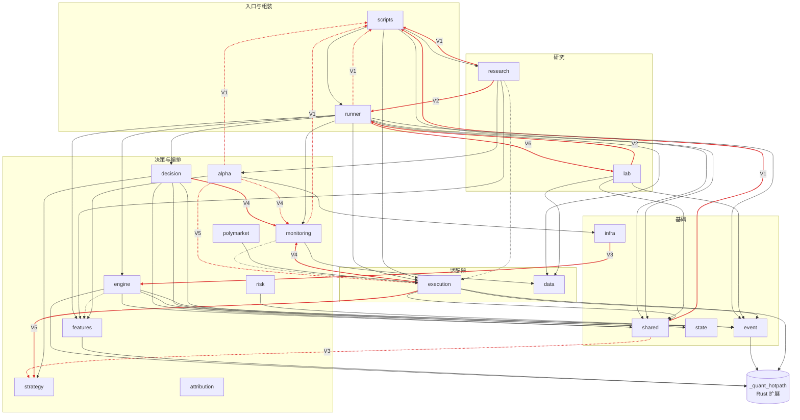
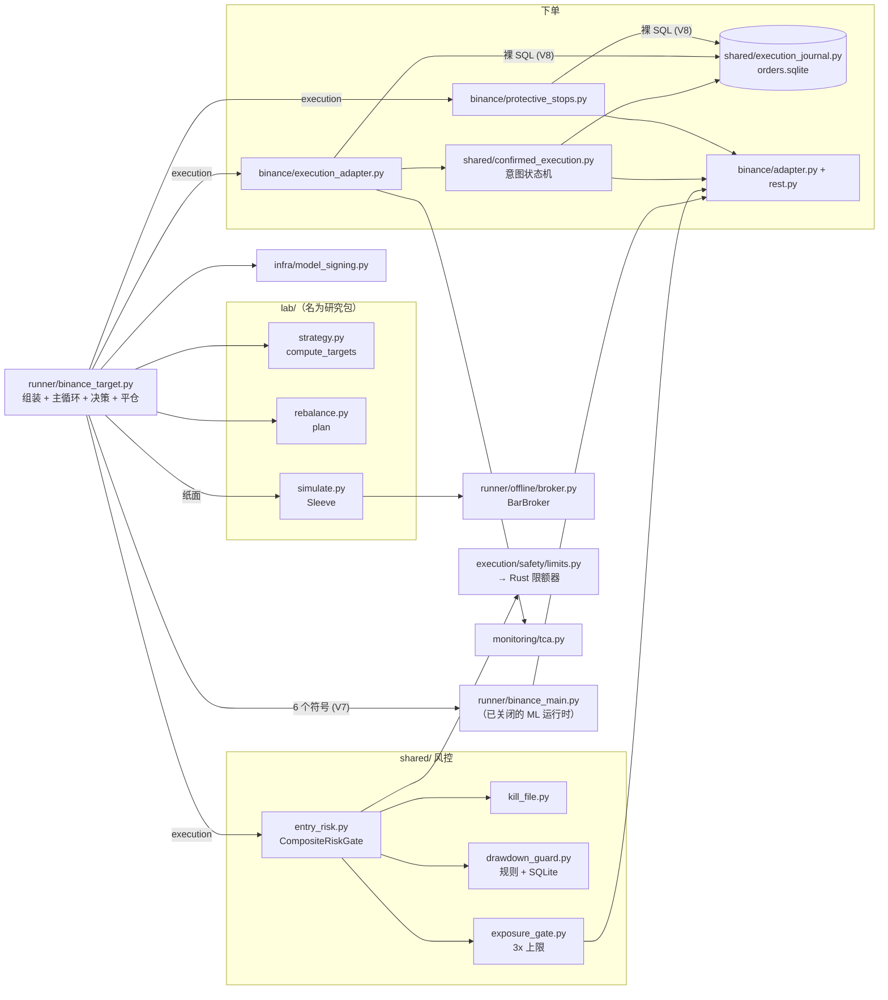

# 现状诊断（阶段 1）

- 基线：分支 `research-infra-pair`，HEAD `e3cd2d6`，诊断日期 2026-11-14。
- 诊断期间没有修改任何已有文件。新增的只有 `docs/arch/` 下的文档和 4 个探针脚本。
- 事实来源只有代码、测试、配置、git 历史和实际运行输出。旧文档（README、`docs/`、`tasks/`、代码注释里的设计说明）在本文件写完之前没有读取。

## 0. 阅读说明

### 0.1 证据标注

| 标注 | 含义 |
|---|---|
| 【代码】 | 读源码所得，附 `路径:行号` |
| 【实际运行结果】 | 我运行了命令或探针脚本，附命令与原始输出 |
| 【测试日志】 | 来自测试运行输出 |
| 【推测】 | 推理所得，未被代码或运行直接证实 |

### 0.2 基线测试结果【测试日志】

在 HEAD `e3cd2d6` 上实际运行（2026-11-14 02:29–02:34 UTC）：

| 命令 | 结果 |
|---|---|
| `python3 -m pytest tests/ --ignore=tests/performance -q -rs` | `2920 passed, 34 skipped, 24 deselected, 312 subtests passed in 324.20s`，exit 0 |
| `ruff check --select E,W,F .` | `All checks passed!` |
| `python scripts/check_local_safety.py` | `Ran 347 tests in 45.858s  OK (skipped=1)` |
| `cargo test` | `224 passed; 0 failed` 加 `3 passed; 0 failed` |

34 个 skip 全部是缺模型文件或仓库外脚本的旧测试（`tests/unit/test_tick_processor.py` 12 个、`tests/unit/test_unified_predictor.py` 12 个、`tests/unit/scripts/test_train_v7.py` 4 个等）。

### 0.3 覆盖深度（请据此判断结论的可靠程度）

| 范围 | 深度 |
|---|---|
| Binance 下单链路：`execution/adapters/binance/`、`shared/`、`runner/binance_target.py`、订单生命周期 | 逐文件精读，关键缺陷用假交易所离线复现，我本人重跑过全部 4 个探针 |
| `runner/binance_main.py`、`lab/`、`infra/model_signing.py`、定时任务脚本 | 精读与本结论相关的段落 |
| Bybit / OKX / Polymarket 适配器，`execution/sim` | 逐文件阅读，部分结论有运行验证 |
| `decision/`、`features/`、`engine/`、`alpha/`、`research/`、`scripts/`、`monitoring/` 的其余部分，Rust 内部实现 | 只做了清单级扫描：静态 import 图、可达性、符号表、定向 grep。这些包内部的逻辑缺陷不在本次结论范围内 |

静态扫描脚本是一次性的，没有入库。入库的是 4 个可重跑的探针：`docs/arch/evidence/probe_*.py`。

## 1. 模块清单与职责

### 1.1 规模

【实际运行结果】（AST 扫描全部 706 个被跟踪的 `.py` 文件）

| 项 | 数量 |
|---|---|
| 非测试 Python 模块 | 456 个，86,788 行 |
| 测试文件 | 250 个，41,740 行 |
| Rust 源文件 | 137 个，35,779 行 |
| 从任一启动面可达的非测试模块 | 270 个，43,056 行 |
| 仅测试可达 | 77 个，14,199 行 |
| 启动面和测试都到不了 | 109 个，29,533 行 |

"启动面"指 `infra/systemd/*`、`docker-compose.yml`、`Dockerfile`、`Makefile`、`.github/workflows/*.yml`、`scripts/*.sh` 引用到的入口，加上 `runner/` 下各 main。可达性按静态 import 闭包计算，并把包的 `__init__.py` 副作用算在内，所以是高估值：`execution/bridge`、`execution/store` 显示为"可达"，实际没有任何运行时调用它们（见 4.1）。

### 1.2 顶层包

"目标层"是按六边形分层判断它本应属于哪一层。

| 包 | 文件 / 行 | 启动面可达行 | 一句话职责（按代码实际行为） | 目标层 |
|---|---|---|---|---|
| `runner/` | 49 / 10,885 | 7,788 | 各运行时的入口与组装根：Binance 目标仓位、Binance ML、Bybit/OKX 旧运行时、shadow、离线回放和三套回测 | application + 组装根 |
| `execution/` | 79 / 9,586 | 8,357 | 四家交易所的 REST/WS 适配器；另有四套未接线的订单模型与一套模拟撮合 | adapters |
| `shared/` | 18 / 3,895 | 3,700 | 三类东西混放：资金安全核心（8 个文件 878 行）、只服务旧运行时的受管状态目录体系（8 个文件 2,799 行）、研究指标 | 拆到 domain / application / adapters / ops |
| `lab/` | 17 / 2,348 | 488 | overlay 策略函数、再平衡、纸面撮合封装，以及研究纪律代码（试验登记、purged walk-forward、前向窗口守卫） | domain + research |
| `engine/` | 14 / 3,123 | 2,904 | 事件驱动管线：协调器、特征钩子、决策桥、执行桥。只有 ML 线和旧运行时使用 | application（ML 线） |
| `decision/` | 12 / 2,508 | 2,504 | ML 线决策模块：信号离散化、持仓管理、仓位大小 | domain（ML 线） |
| `features/` | 23 / 4,846 | 4,106 | ML 线特征：增量计算一套、批量计算一套 | domain（ML 线） |
| `alpha/` | 22 / 4,317 | 437 | 模型加载（在用 4 个文件）；训练与重训流程（仅测试可达） | research |
| `strategy/` | 10 / 601 | 601 | 旧运行时的品种配置常量、市场状态检测 | domain（旧线） |
| `event/` | 5 / 607 | 607 | 事件类型与事件头；Python 类包装 Rust 扩展里的类型 | domain |
| `state/` | 4 / 466 | 464 | 状态快照与内存 / SQLite 状态存储（ML 线） | domain + adapters |
| `risk/` | 5 / 862 | 0 | 一套 kill switch、风险聚合器和风险决策类型。没有任何运行时使用 | 删除 |
| `data/` | 23 / 4,058 | 1,058 | 因果 K 线加载与校验（在用）；14 个下载器，其中 13 个无人引用 | adapters + research |
| `monitoring/` | 30 / 7,400 | 2,889 | 通知、TCA 日志、看门狗、IC 暂停开关；另有 15 个不可达的分析脚本 | infrastructure + ops |
| `attribution/` | 7 / 397 | 318 | 盈亏与成本归因，只被旧运行时使用 | ops |
| `infra/` | 13 / 1,004 | 1,004 | 产物签名（在用）；配置加载器、effects、metrics（无调用方）；systemd 单元 | infrastructure |
| `polymarket/` | 21 / 2,685 | 1,981 | 预测市场信号流程（启动即 ImportError）和一个只读行情采集器 | 冻结 |
| `scripts/` | 53 / 10,046 | 3,850 | 运维 CLI、CI 检查、状态备份迁移、以及 25 个不可达的一次性分析脚本 | ops |
| `research/` | 51 / 17,154 | 0 | 历史研究脚本和旧回测。全部不可达，其中 9 个文件有无法解析的 import | research 或删除 |
| Rust crate | 137 / 35,779 | — | `_quant_hotpath` 扩展：特征、状态 reducer、事件类型、风控、决策数学、研究统计 | 多数属 ML 线 |
| `rust_bin/` | 6 / 2,719 | 0 | 独立交易二进制 `quant_trader`，自带行情、决策和 WS 下单 | 冻结或删除 |

### 1.3 运行时入口

| 入口 | 谁启动它 | 默认模式 | 能否对真实账户下单 |
|---|---|---|---|
| `runner.binance_target` | `infra/systemd/binance-target.service:16`，带 `--dry-run`，`Restart=on-failure` | 纸面 | 需人工加 `--enable-execution`（`runner/binance_target.py:375-378`）。主网还需 `BINANCE_TESTNET=0` 且 spec 的 `passed` 为 true（`:222-223`） |
| `runner.binance_main` | 没有任何启动面 | 纸面（`runner/binance_main.py:590-592`） | 同上，闸门在 `:348-349` |
| `runner.alpha_main` | `bybit-alpha.service:13`、`okx-alpha.service:34`，均 `Restart=always`，都没带 `--enable-execution` | dry-run（`runner/alpha_cli.py:19-21`） | 只有 Bybit 可以（`runner/portfolio_risk.py:62-63`）。Binance 被拒（`runner/alpha_main.py:201-202`） |
| `runner.shadow_main` | `docker-compose.yml:11`、`Dockerfile:54` | 只观察信号 | 否，不接账户 |
| `runner.daily_live_runner` | `daily-live-runner.timer`，每天 00:35 UTC | dry-run | 否。`--live` 被拒（`runner/daily_live_runner.py:130-134,302-307`） |
| `polymarket.runner` | `polymarket-maker.service:12`，`Restart=always` | — | 否。首个周期即 ImportError，见 4.2 |
| `polymarket.collector` | `polymarket-collector.service:12` | 只读采集 | 否 |
| `quant_trader`（Rust） | 没有任何启动面 | paper | 需 `--live` 且配置 `mode: live`（`rust_bin/main.rs:71-72`）。这条通道不经过 Python 侧的任何风控 |

另有 11 个 systemd 定时器（对账、看门狗、IC 暂停开关、备份等）。我逐个检查了它们指向的脚本，没有发现会下单、调高上限或重启服务的代码：

- `scripts/okx_ramp_up.py:225-227` 只打印建议。【代码】
- `monitoring/watchdog.py` 只调 `systemctl is-active` 并发通知。【代码】
- 全仓库非测试代码里没有 `systemctl restart` 或 `docker restart` 调用。【实际运行结果】grep 结果只有 `is-active` 和 `show`。

### 1.4 资金关键路径（逐文件）

唯一候选策略的运行时是 `runner.binance_target`。它的 execution 模式涉及以下文件：

| 文件 | 行数 | 职责 | 目标层 |
|---|---|---|---|
| `runner/binance_target.py` | 409 | 组装根 + 主循环 + 每小时决策 + 成交消费 + 平仓，全在一个文件 | application + 组装根 |
| `lab/strategy.py` | 157 | 目标权重函数，研究与实盘共用同一个 `compute_targets` | domain |
| `lab/rebalance.py` | 61 | 目标权重 → 订单意图，纯函数 | domain |
| `lab/simulate.py` | 111 | 纸面 sleeve：研究撮合器加再平衡，研究与纸面运行时共用 | application（纸面适配） |
| `runner/offline/broker.py` | 356 | 研究撮合器 `BarBroker` | adapters（模拟交易所） |
| `shared/entry_risk.py` | 76 | 入场组合风控门 `CompositeRiskGate` | application |
| `shared/exposure_gate.py` | 57 | 3 倍总敞口上限，常量 `MAX_TOTAL_LEVERAGE` | domain 规则 + 账户端口 |
| `shared/drawdown_guard.py` | 131 | 日 / 周回撤闩锁，规则与 SQLite 写在一个类里 | domain 规则 + 存储适配器 |
| `shared/kill_file.py` | 82 | 文件型急停开关与其命令行 | adapters |
| `execution/safety/limits.py` | 89 | 下单频率与名义限额，包装 Rust 的 `RustOrderLimiter` | domain |
| `shared/confirmed_execution.py` | 343 | 订单意图状态机：先落库、后发单、只查不重发 | application |
| `shared/execution_journal.py` | 111 | SQLite 三张表：意图、成交、消费者检查点 | adapters |
| `shared/strategy_position.py` | 46 | 持仓投影，纯计算 | domain |
| `shared/execution_lease.py` | 40 | 进程互斥文件锁 | infrastructure |
| `execution/adapters/binance/execution_adapter.py` | 288 | 把订单事件变成持久化意图，减仓定量，对账 | adapters（混入应用逻辑） |
| `execution/adapters/binance/protective_stops.py` | 149 | 交易所侧止损单的维护 | application |
| `execution/adapters/binance/adapter.py`、`rest.py` | 490 + 253 | Binance REST 封装、签名、错误分类 | adapters |
| `infra/model_signing.py` | 191 | 产物 HMAC 验签 | infrastructure |
| `runner/binance_main.py` 的 6 个符号 | — | `EquitySource`、`EventJournal`、`bar_from_kline`、`EntryReadinessGate`、`build_adapters`、`check_stop_inside_liquidation` | 应从 ML 运行时移出 |

纸面模式（当前 systemd 单元实际运行的模式）不构造上表中任何风控或执行对象。它只用到 `lab.*`、`BarBroker`、行情读取和 `ExecutionLease`（`runner/binance_target.py:104-105,242-243`）。

### 1.5 其余子包

| 子包 | 状态 | 职责 |
|---|---|---|
| `runner/offline/` | 在用（CI、研究、纸面） | ML 线的离线回放与固定时间戳切分研究；其中 `broker.py` 被 overlay 研究和纸面运行时共用 |
| `runner/builders/` | 旧运行时在用 | `alpha_main` 的对象构造；`rust_components_builder.build_rust_components` 没有调用方 |
| `runner/backtest/`、`backtest_runner*.py`、`backtest_multi.py`、`backtest_cli.py`、`replay_runner.py` | 仅测试可达 | 另外两套回测 / 回放实现 |
| `runner/control_plane.py` | 无任何引用 | 操作员控制面类 |
| `runner/gates/portfolio_risk_file.py` | 仅测试引用 | 文件型组合风险读取器 |
| `execution/adapters/{bybit,okx,polymarket}/` | 冻结交易所 | REST / WS 适配器 |
| `execution/adapters/common/` | 无适配器使用 | 7 个工具文件，其中 `hashing.hmac_sign` 调用即 TypeError |
| `execution/bridge/`、`execution/store/` | 未接线 | 另一套带重发语义的 `ExecutionBridge` 及其存储 |
| `execution/models/` | 15 个文件里 3 个在用 | 规范化订单 / 成交 / 持仓数据类 |
| `execution/sim/` | 仅测试和旧回测使用 | 第三到第五份撮合 / 成本实现 |
| `alpha/retrain/`、`alpha/training/`、`alpha/models/` | 仅测试可达 | 训练与重训流程，含 2 处无法解析的 import |
| `data/downloads/` | 1 个在用，13 个无引用 | `binance_public.py` 是当前快照下载器 |
| `data/quality/` | 在用 | `causal_bars.py` 定义 `Bar` 与闭合 K 线聚合 |
| `infra/config/`、`infra/effects.py`、`infra/metrics/`、`infra/runtime/` | 无运行时调用方 | 配置服务、effects 协议、指标注册 |
| `monitoring/daily_reconcile*.py` | 不可达 | 旧日志对账；`daily_reconcile_report` 导入即失败（见 2.3） |
| `research/scripts/`、`research/strategies/`、`research/backtesting/`、`research/model_registry/` | 不可达 | 历史研究脚本。`research/strategies/run_*.py` 4 个文件含直接下单代码（见 R18） |

## 2. 依赖图

### 2.1 包级依赖

【实际运行结果】AST 扫描得到 2,587 条内部 import 边。下图只画跨包边。实线是模块加载时的 import，虚线是函数体内的 import。红色是分层违规，编号见 2.2。



### 2.2 分层违规

仓库里没有任何 import 约束工具或架构测试（grep `import-linter|importlinter|lint-imports` 无结果）。下表按"基础不得依赖上层、库不得依赖入口、核心不得依赖运维"判定。行号来自 AST 扫描。【实际运行结果】

| 编号 | 违规 | 位置 |
|---|---|---|
| V1 | 库代码依赖入口脚本 | `shared/release_acceptance.py:19` → `scripts/check_paper_runtime.py`（顶层 import，与 `scripts/check_paper_runtime.py:10` 构成包级循环）；`runner/batch_predictor.py:42`、`runner/builders/alpha_builder.py:416`、`monitoring/ic_decay_monitor.py:122` → `scripts/run_full_backtest.py`；`runner/daily_paper_runner.py:51,59` → `scripts/daily_poc.py`；`alpha/retrain/multi_tf.py:357` → `scripts/training/train_4h_daily.py` |
| V2 | 研究代码依赖运行时包 | `lab/simulate.py:17`、`lab/breakout_study.py:50` → `runner/offline/broker.py`；`lab/data.py:52`、`lab/pair.py:36` → `runner/offline/report.py`；`research/factor_backtest.py:25-26` → `runner/backtest/*` |
| V3 | 基础层向上依赖 | `infra/effects.py:22` → `engine/clock.py`；`shared/release_acceptance.py:168` → `strategy/config.py` |
| V4 | 核心逻辑依赖监控 | `decision/modules/alpha.py:22` → `monitoring/decision_audit.py`；三个执行适配器（binance `:39`、bybit `:21`、okx `:22`）→ `monitoring/tca.py`；`alpha/retrain/pipeline.py:568` → `monitoring/notify.py` |
| V5 | 适配器与策略互相依赖 | `execution/order_utils.py:8` → `strategy/config.py`（经 `execution/__init__.py:14` 在每次 `import execution.*` 时执行）；`alpha/model_loader_prod.py:201` → `execution/adapters/bybit` |
| V6 | 运行时依赖名为"研究"的包 | `runner/binance_target.py:34-38` → `lab.data`、`lab.orders`、`lab.rebalance`、`lab.simulate`、`lab.strategy`。共用同一份策略函数是有意的，问题在于生产决策代码放在研究包里 |
| V7 | 候选运行时依赖已关闭的 ML 运行时 | `runner/binance_target.py:39,109,246,369` 从 `runner/binance_main.py` 取 6 个符号 |
| V8 | 适配器绕过所有者直接写表 | `execution/adapters/binance/execution_adapter.py:225-231` 对 `submissions` 表裸 `INSERT`，`:234` 直接写 `ConfirmedExecutor.pending`；`execution/adapters/binance/protective_stops.py:48-53` 在同一个库里自建 `protective_stops` 表；`runner/binance_target.py:113,306` 改写适配器私有属性 `_status_callback`、`_ready` |
| V9 | 领域规则里直接做 I/O | `shared/confirmed_execution.py:107-155` 把互斥规则写成 SQL，`:209-210` 在提交路径内 `time.sleep`；`shared/drawdown_guard.py:45,62` 直接开 SQLite、取系统时钟；`shared/exposure_gate.py:26,30,34` 门内直接调适配器 |
| V10 | 适配器里读环境变量、选存储路径 | `execution/adapters/binance/execution_adapter.py:57,72`（`RISK_SCOPE`、`ORDER_JOURNAL_PATH`） |

资金路径上的协作者没有接口定义：`CompositeRiskGate` 的 7 个构造参数全是 `Any`（`shared/entry_risk.py:16-18`），`ConfirmedExecutor` 的 `adapter` 是 `Any`（`shared/confirmed_execution.py:53`）。全仓库只有一个执行相关协议 `engine/execution_bridge.py:24 ExecutionAdapter`，只含 `send_order` 一个方法。【代码】

### 2.3 循环依赖

【实际运行结果】

- **包级**：19 个顶层包里有 12 个处于同一个循环组：`alpha, decision, engine, execution, infra, lab, monitoring, polymarket, research, runner, scripts, shared`。只算加载时 import 仍有 10 个。
- **模块级，加载时即成环**（2 组）：
  - `monitoring.daily_reconcile` ↔ `monitoring.daily_reconcile_report`。实测 `python3 -B -c "import monitoring.daily_reconcile_report"` 报 `ImportError: cannot import name 'print_report' from partially initialized module`。
  - `alpha.retrain.multi_tf` ↔ `alpha.retrain.pipeline`。
- **模块级，含函数内 import**（另 6 组）：`features.enriched_computer / enriched_feature_getters / enriched_symbol_state / enriched_trackers`（4 个模块）；`runner.backtest_cli / backtest_runner / backtest_runner_wf`；`polymarket.collector / collector_intra / collector_main`；`engine.feature_hook / feature_hook_dominance`；`monitoring.ic_decay_cli / ic_decay_monitor`；`research.alpha_factor / orthogonalize`。

### 2.4 包初始化造成的隐式耦合

【实际运行结果】

| 导入语句 | 实际加载的仓库内模块数 |
|---|---|
| `import runner.binance_target` | 26（data 7、lab 6、runner 5、event 5、shared 3），并加载 pandas、numpy、`_quant_hotpath` |
| `import runner.alpha_main` | 137（其中 execution 49） |
| `import execution.safety.limits`（只想要一个限额类） | 40，含 `execution.bridge.*`、`execution.store.*`、`strategy.config` |
| `import execution.adapters.binance.execution_adapter` | 65，含冻结的 `execution.adapters.bybit.*` |

原因是三个包的 `__init__.py` 急切重导出：`execution/__init__.py:10-14`、`execution/adapters/__init__.py:9`（导入 Bybit 适配器）、`execution/models/__init__.py:7-42`。后果是 Bybit 适配器或 `strategy/config.py` 的任何导入期错误都会让 Binance 运行时起不来。

`runner.binance_target` 的静态闭包是 71 个模块 13,614 行，其中包含整条已关闭的 ML 栈（`decision/modules/alpha.py`、`engine/coordinator.py`、`features/enriched_*`），仅因为它从 `runner.binance_main` 取了 6 个符号。

### 2.5 候选运行时的实际调用链



## 3. 耦合热点

【实际运行结果】git 历史共 684 次提交（2026-02-22 至 2026-11-14），其中 528 次集中在 2026-03。

### 3.1 被依赖最多的 10 个文件（非测试导入者数量）

| 排名 | 文件 | 非测试导入者 | 测试导入者 | 行数 |
|---|---|---|---|---|
| 1 | `event/types.py` | 25 | 25 | 24 |
| 2 | `event/header.py` | 22 | 14 | 98 |
| 3 | `features/enriched_computer.py` | 16 | 11 | 167 |
| 4 | `shared/runtime_state.py` | 15 | 13 | 299 |
| 5 | `monitoring/notify.py` | 14 | 1 | 174 |
| 6 | `execution/adapters/bybit/config.py` | 12 | 8 | 50 |
| 7 | `data/quality/causal_bars.py` | 12 | 6 | 124 |
| 8 | `features/batch_feature_engine.py` | 12 | 3 | 333 |
| 9 | `infra/model_signing.py` | 12 | 1 | 191 |
| 10 | `engine/coordinator.py` | 10 | 12 | 521 |

`event/types.py` 只有 24 行，是一个向后兼容的重导出壳，真正的定义在 `event/events.py` 和 `event/domain.py`。`event/events.py:15` 和 `event/header.py:10` 在加载时导入 Rust 扩展，所以任何用到事件类型的模块（包括 `lab/orders.py`）都依赖已编译的 `_quant_hotpath`。

### 3.2 改动最频繁的 10 个文件（非测试 `.py`，按提交次数）

| 排名 | 文件 | 提交数 | 2026-11 以来 | 行数 | 备注 |
|---|---|---|---|---|---|
| 1 | `runner/alpha_main.py` | 64 | 12 | 1,375 | `main()` 函数 1,189 行（`:182`） |
| 2 | `decision/modules/alpha.py` | 38 | 5 | 1,452 | `decide()` 方法 671 行（`:239`） |
| 3 | `runner/builders/alpha_builder.py` | 32 | 10 | 982 | `_build_data_sources` 360 行 |
| 4 | `features/enriched_computer.py` | 28 | 0 | 167 | 同时是入度第 3 |
| 5 | `engine/coordinator.py` | 27 | 1 | 521 | 同时是入度第 10 |
| 6 | `engine/feature_hook.py` | 26 | 0 | 748 | |
| 7 | `features/batch_feature_engine.py` | 23 | 0 | 333 | 同时是入度第 8 |
| 8 | `runner/backtest_runner.py` | 23 | 0 | 395 | 含 4 处无法解析的 import |
| 9 | `engine/pipeline.py` | 20 | 0 | 316 | |
| 10 | `scripts/run_bybit_alpha.py` | 16 | 1 | 7 | 7 行的转发壳 |

唯一一对跨包、共同修改 8 次以上的文件是 `decision/modules/alpha.py` 与 `runner/alpha_main.py`（15 次）。

### 3.3 解读

- 改动最频繁的前 9 个文件全部属于 ML 线或 Bybit/OKX 旧运行时。按提交历史，过去的工程投入集中在这两条线上。
- 既被广泛依赖又频繁改动的是 `features/enriched_computer.py`、`features/batch_feature_engine.py`、`engine/coordinator.py`、`event/types.py`。
- 候选策略的资金路径文件改动次数都很低：`shared/confirmed_execution.py` 4 次，`runner/binance_main.py` 3 次，`shared/execution_journal.py` 3 次。它们全部写于 2026-11，没有经历过实盘。

## 4. 死代码、重复代码、空壳文件

### 4.1 死代码

| 项 | 规模 | 证据 |
|---|---|---|
| `research/` 全部 | 51 文件 17,154 行 | 【实际运行结果】从任何启动面不可达；48 个文件连测试也到不了 |
| `scripts/` 中 25 个一次性脚本 | 6,196 行 | 同上。例如 `scripts/dz_sweep.py`、`scripts/ab_test_eth_short.py`、`scripts/run_portfolio_backtest.py` |
| `data/downloads/` 中 13 个下载器 | 约 2,700 行 | 无 Python 导入者，无启动面引用 |
| `monitoring/` 中 15 个文件 | 4,511 行 | 不可达，例如 `tracker.py`、`live_vs_backtest.py`、`oos_sharpe_monitor.py`、`daily_reconcile*.py` |
| Python `risk/` 包 | 5 文件 862 行 | `q.py reach risk/kill_switch.py` → 启动面 False、测试 True。实际在用的急停是 `shared/kill_file.py`（Binance）和 Rust 的 `RustKillSwitch`（旧运行时，`runner/alpha_main.py:319`） |
| `execution/bridge/**` | 914 行 | `ExecutionBridge(venue_clients=...)` 全仓库无实例化。它带"超时重发最多 3 次"的语义（`execution/bridge/infra.py:21`），与在用链路相反，却由 `execution/__init__.py:10` 对外导出 |
| `execution/store/**` | 321 行 | 唯一消费者是上面那个未接线的 bridge |
| `execution/models/` 中 9 个文件 | 955 行 | 导入者只有 `execution/models/__init__.py` 和 5 个单元测试；其中 5 个文件连测试都没有 |
| `execution/adapters/common/**` | 331 行 | 四家适配器都不导入它 |
| `execution/adapters/binance/ws_kline_client.py` | 225 行 | 唯一引用 `runner/alpha_main.py:929` 位于 `venue=="binance"` 分支，而 `:201-202` 对同一条件先 `raise SystemExit` |
| `execution/order_utils.py`、`execution/balance_utils.py` | 149 行 | 除包 `__init__` 重导出外，前者只有 2 个测试导入，后者无导入者 |
| `execution/tests/` | 7 个文件 | 1 行的 `__init__.py` 加 6 个 0 字节 fixture |
| `execution/sim/` | 约 780 行 | 只被测试和旧回测使用；`venue_emulator.py` 连测试都没有 |
| `runner/control_plane.py` | 138 行 | 无任何引用 |
| `runner/builders/rust_components_builder.build_rust_components` | 94 行 | 无调用方。它是 `RustOrderStateMachine`、`RustRiskEvaluator` 在 Python 侧唯一的构造点 |
| 三套旧回测：`runner/backtest/`、`runner/backtest_*.py`、`runner/replay_runner.py`、`engine/replay.py` | 约 2,900 行 | 仅测试可达 |
| `alpha/retrain/`、`alpha/training/`、`alpha/models/` | 约 3,200 行 | 仅测试可达 |
| Rust 导出 | 191 个里 46 个在 Python 中无处引用，12 个仅测试引用 | 【实际运行结果】无处引用的包括 `RustRiskGate`、`RustExitManager`、`RustCheckpointStore`、`RustDedupStore`、`RustOrderState`、`RustWsClient`、`RustDrawdownBreaker`、`RustAdaptiveStopGate` |
| `rust_bin/` | 2,719 行 | 没有任何启动面、脚本或 CI 步骤启动它；`Dockerfile:22` 只为编译 crate 复制源码 |

### 4.2 无法运行的代码

【实际运行结果】静态检查发现非测试代码中 23 处内部 import 无法解析。

| 文件 | 问题 |
|---|---|
| `polymarket/runner.py:23` | 导入 `PolymarketClient`，而 `execution/adapters/polymarket/client.py:28` 定义的是 `PolymarketRestClient`。该行不在 try 内。`polymarket-maker.service` 以 `Restart=always` 启动它，会形成崩溃循环 |
| `runner/backtest_runner.py:176,237,238,252` | 导入不存在的 `alpha.inference.bridge`、`decision.regime_bridge`、`decision.regime_policy`、`data.loaders.funding_rate` |
| `research/strategies/run_bybit_mm.py:24-27` | 导入不存在的 `execution.market_maker.*`、`scripts.ops.*` |
| `research/backtesting/backtest_kernel.py:331,523`、`research/scripts/bear_alpha_research.py:188`、`research/scripts/ensemble_4h_research.py:160` | 导入不存在的模块 |
| `monitoring/daily_reconcile_report.py` | 循环 import，导入即失败（见 2.3） |
| `monitoring/data_quality_check.py:290,317` | 导入 `monitoring.notify.send_notification`，该名字不存在 |
| `alpha/retrain/multi_tf.py:155,239`、`monitoring/oos_sharpe_monitor.py:82`、`data/downloads/download_cross_market.py:95,118,339` | 导入不存在的模块，位于 try 内 |
| `docker-compose.yml:67` | `quant-framework` 服务指向 `runner.live_runner`，该文件不存在 |
| `docker-compose.yml:43`、`Dockerfile:58` | `quant-live` 的品种含 `SUIUSDT`、`AXSUSDT`，不在 `strategy/config.py:81-109` 的配置里，`runner/alpha_main.py:204-205` 会在启动时抛错 |
| `infra/systemd/binance-target.service:16` | 指向 `models_binance/strategy/final_spec.json`，而 `git ls-files models_binance` 为空，目录也是空的。从干净检出无法启动 |

### 4.3 同一概念的多份实现

| 概念 | 份数 | 位置 | 在用的是哪份 |
|---|---|---|---|
| 订单 / 意图状态机 | 5 | `shared/confirmed_execution.py` + `execution_journal.py`；`execution/rust/order_state_machine.rs`；`execution/models/intents.py`；`execution/bridge/execution_bridge.py` + `common_rust/saga.rs`；`execution/models/commands.py` + `execution/store/ack_store.py` | 第一份。它的状态是分散在 3 个文件里的自由字符串，没有转移表 |
| 名为 `ExecutionBridge` 的类 | 2 | `engine/execution_bridge.py:56`；`execution/bridge/execution_bridge.py:98` | 前者。`from execution import ExecutionBridge` 拿到的是后者 |
| 急停开关 | 4 | `shared/kill_file.py`；`risk/kill_switch.py`；Rust `RustKillSwitch`；`monitoring/live_ic_killswitch.py` | Binance 用第一个，旧运行时用第三、四个 |
| 回撤 / 熔断 | 3 | `shared/drawdown_guard.py`；Rust `risk/rust/drawdown.rs`；Rust `RustCircuitBreaker` | Binance 用第一个 |
| 撮合 / 成本模型 | 5 | `runner/offline/broker.py`；`execution/sim/paper_broker.py`；`execution/sim/replay_adapter.py`；`runner/backtest/adapter.py`；`execution/sim/cost_model.py`。费率默认值互不相同 | 第一份 |
| 回测 / 回放驱动 | 4 | `runner/offline/`；`runner/backtest_runner*.py`；`runner/replay_runner.py`；`engine/replay.py` | 第一份 |
| 测试网判定规则 | 4 | `runner/binance_target.py:382`；`runner/alpha_main.py:142`；`scripts/portfolio_risk_monitor.py:76` 与 `scripts/cross_venue_reconcile.py:83`（"有测试网密钥即测试网"）；`execution/adapters/binance/urls.py:28`（函数默认主网）对 `config.py:23`（默认测试网） | 运行时用第一份，监控脚本用第三份 |
| 订单终态集合字面量 | 6 处 | `shared/confirmed_execution.py:33`、`shared/portfolio_reservations.py:22`、`shared/runtime_migration.py:219`、`runner/binance_main.py:52`、`runner/binance_target.py:131` 等 | 各用各的。其中 3 处含 `not_found`，3 处不含 |
| deflated Sharpe | 2 | `shared/ic_metrics.py:129`（无调用方）；`lab/metrics.py:68,91` | 后者 |
| 特征计算 | 3 | `features/enriched_*`（增量）；`features/batch_*`（批量）；Rust `features::engine` | ML 线三份都用 |
| maker 限价偏移 2bps | 2 处硬编码 | `lab/simulate.py:39`；`execution/adapters/binance/execution_adapter.py:54` | 两处独立，靠默认值碰巧相等 |

### 4.4 复制粘贴

【实际运行结果】

- 三个执行适配器：`bybit/execution_adapter.py` 与 `binance/execution_adapter.py` 有 188 行逐行相同（difflib ratio 0.76）。安全语义已经漂移：只有 Binance 传了 `not_found_grace_seconds`（`:75`），OKX 没有重复意图防护。
- `load_schedule` 函数体在 5 个 `research/scripts/ic_analysis_*.py` 里完全相同。
- `_code_identity` 在 3 个 `lab/*_study.py` 里完全相同。
- `_ensure_utc` 在 `runner/backtest_multi.py`、`runner/backtest_runner.py`、`state/store.py` 里完全相同。
- `close_position` 在 Bybit 与 OKX 适配器里完全相同（`execution/adapters/bybit/adapter.py:653`、`execution/adapters/okx/adapter.py:592`）。
- `shared/` 内部：路径校验函数 6 份，严格 JSON 解析器 3 份，租约文件名公式 2 份。【代码】

### 4.5 空壳与无人读取的配置

- 空壳文件 60 个，绝大多数是只做重导出或为空的 `__init__.py`。非 `__init__` 的有 `event/types.py`（重导出）、`polymarket/config.py`（重导出）、`scripts/run_bybit_alpha.py`（7 行转发）、`alpha/retrain_15m.py`（6 行）。
- `config/` 下 10 个文件里 8 个没有任何代码引用：`alerts.live.yaml`、`burnin.paper.yaml`、`burnin.shadow.yaml`、`burnin.testnet.yaml`、`hyperliquid.yaml`、`production.yaml`、`production.live.yaml`、`production.local.yaml`。【实际运行结果】
- `infra/config/examples/` 下 13 个 yaml 里 12 个无引用。唯一被引用的 `live.yaml` 只出现在指向不存在入口的 `docker-compose.yml:67`。
- `infra/config/loader.py`、`infra/config/core.py` 除 `infra/__init__.py` 外没有导入者。
- `pyproject.toml` 的 coverage 与 mypy 配置引用了 5 个不存在的包：`core`、`policy`、`portfolio`、`regime`、`ext`。
- `.env.example` 只列了 `BYBIT_API_KEY`、`BYBIT_API_SECRET`、`BYBIT_BASE_URL`。Binance 运行时读取的 `RISK_SCOPE`、`BINANCE_TESTNET`、`QUANT_MODEL_SIGN_KEY`、`BINANCE_MAX_*`、`MAX_*_DRAWDOWN_PCT` 都不在里面。
- `config/polymarket.yaml` 实际加载结果等于全默认值：YAML 把所有键放在顶层 `polymarket:` 之下，而 `from_yaml` 只按顶层键过滤。

## 5. 风险排序：可能导致实盘资金损失的问题

### 5.1 前提

当前没有任何启动面以 execution 模式启动任何运行时：`binance-target.service` 是 `--dry-run`，两个 alpha 单元没带 `--enable-execution`。所以下表的资金后果都以"人工开启 execution 之后"为前提。等级的含义：

- **高**：开启 execution 后，在正常运维场景下可触发，后果是持仓失去保护、急停失效或敞口超出预期。
- **中**：需要额外条件才触发，或后果是阻断交易而非扩大损失。
- **低**：潜在问题，当前没有触发路径。

"复现"一列为"是"的，都能用 `docs/arch/evidence/` 下的探针离线重跑（真实运行时类加测试用的假交易所，不联网）。

### 5.2 清单

| # | 级别 | 问题 | 复现 | 不变量 |
|---|---|---|---|---|
| R1 | 高 | 平仓失败后同一小时内不再重试 | 是 | kill-switch |
| R2 | 高 | 有挂单时 kill 平仓被跳过，挂着的入场单在 kill 期间继续成交 | 是 | kill-switch |
| R3 | 高 | 保护止损挂不上时只记一条日志，仍允许入场 | 是 | kill-switch |
| R4 | 高 | 止损与平仓按本地账本定量，账本为 0 时对交易所上的真实仓位不动作 | 部分 | 对账 |
| R5 | 高 | 急停命令行的默认路径不是候选运行时读取的路径；文件不存在即视为未激活 | 是 | kill-switch |
| R6 | 高 | 状态库缺失或 `RISK_SCOPE` 改名后回撤闩锁静默消失 | 是 | 风控上限 |
| R7 | 高 | 减仓会被订单库状态静默阻断，且不写日志 | 部分 | kill-switch |
| R8 | 中 | 止损触发后拿不到实际订单号，成交永不入账 | 是 | 订单状态机 |
| R9 | 中 | 单笔订单成交超过 100 笔后永不结算，之后的减仓被永久拒绝 | 是 | 订单状态机 |
| R10 | 中 | 一次行情请求失败进程即退出；重启后纸面状态归零 | 否 | 回测/实盘一致性 |
| R11 | 中 | 账户杠杆设置发生在研究闸门、scope 校验和 spec 验签之前 | 否 | 风控上限 |
| R12 | 中 | 回撤阈值没有硬上限、没有累计上限；下单日限额重启清零 | 部分 | 风控上限 |
| R13 | 中 | 权益未知时策略自身的减仓与清仓意图不生成 | 是 | 订单状态机 |
| R14 | 中 | 风控门靠调用方自觉调用，组件漏传不报错 | 否 | 风控上限 |
| R15 | 中 | 监控脚本与运行时用不同规则选账户 | 否 | 对账 |
| R16 | 中 | 除限频外的所有 4xx 都当作确定拒绝 | 否 | 订单状态机 |
| R17 | 中 | `binance_main` 特有：改写操作员的急停文件；执行仓位是纸面的 3 倍；非 USDT 手续费的成交无法入账 | 否 | 多项 |
| R18 | 中 | 冻结交易所没有"禁止执行"的硬开关；4 个研究脚本默认真实下单 | 否 | 风控上限 |
| R19 | 低 | 旧运行时的暂停会被定时任务自动解除；模型权重在进程内在线更新 | 否 | 风控上限 |
| R20 | 低 | 执行租约按目录加锁，同一账户可同时跑两个运行时 | 是 | 对账 |
| R21 | 低 | 研究纪律守卫靠约定，可以绕过 | 否 | 无前视 |
| R22 | 低 | 测试门禁只覆盖 47% 的测试；Binance 安全文件不在 CI 的 lint 清单里 | 是 | 全部 |

### 5.3 逐条说明

**R1 平仓失败后同一小时内不再重试**

- 【代码】平仓单的 id 由品种、K 线时间、原因和序号拼成：`runner/binance_target.py:152`。平仓用最后一根 K 线提交：`:212`。适配器对已存在的 id 直接返回：`execution/adapters/binance/execution_adapter.py:144-145`。
- 【实际运行结果】`python3 -B docs/arch/evidence/probe_flatten_retry_and_pending.py <空目录> a`。对 kill 平仓单注入一次交易所拒绝后：
  ```
  A1..A6 cycle: BTC order POSTs since kill=1 venue_pos=-0.15 ledger=-0.15
  A journal rows (kill_switch): [('BTCUSDT:1703037600000:kill_switch:0', 'rejected', 1, 1)]
  A next bar: BTC order POSTs since kill=2 venue_pos=0.00 ledger=0.00
  ```
  6 个周期只发了 1 次单，仓位不变，下一根 K 线才平掉。
- 触发条件：急停或回撤闩锁后的第一张平仓单遇到限频、任意 4xx、超时。后果：最长约 1 小时持仓原样暴露，而事件日志里每 5 秒都有一行"intent"，看起来像在平仓。
- 已有缓解：已挂上的交易所止损仍有效（默认距离 8%，`runner/binance_target.py:374`）。

**R2 有挂单时 kill 平仓被跳过**

- 【代码】`runner/binance_target.py:209`：`if qty == 0 or self.pending or not self.bars: return`。撤销入场挂单的调用点只在减仓分支内（`execution/adapters/binance/execution_adapter.py:163`）和到期时。
- 【实际运行结果】同一探针，场景 `e`（maker 入场单部分成交后激活 kill）：
  ```
  E2..E4 kill+flatten active: POSTs since kill=0 entry status=PARTIALLY_FILLED venue_pos=-0.001
  E5 entry filled more under kill: venue_pos=-0.003 ledger=-0.003 POSTs since kill=0
  ```
- 后果：急停期间仓位不减反增，直到挂单到期（最长 `ttl_bars` 小时）。
- 适用范围：spec 的 `execution` 为 `maker` 时整段挂单期都成立。现有 overlay 的 `final_spec.json` 是 `market`，窗口缩短为订单未结算期间（未知结果最长 90 秒）。

**R3 保护止损挂不上时仍允许入场**

- 【代码】`execution/adapters/binance/protective_stops.py:129-136` 被拒只追加一条 issue。`runner/binance_target.py:311-312` 只有含 `stop_breached` 的 issue 才触发平仓。入场就绪标志只由对账问题决定（`execution_adapter.py:284`）。
- 【实际运行结果】`python3 -B docs/arch/evidence/probe_stop_trigger_and_reject.py <空目录>`，C 段：
  ```
  cycle #3: issues=['BTCUSDT: protective stop rejected: HTTP 400: {"code":-4120,...}'] | entries _ready=True | has_active_stop=False
  venue position still open: 0.1
  ```
- 后果：持仓没有交易所侧止损，运行时还能继续加仓。此时若进程退出（见 R10），仓位完全裸露。这条流里没有任何告警调用。

**R4 止损与平仓按本地账本定量**

- 【代码】止损数量读消费者检查点而非交易所持仓：`protective_stops.py:73-78`，为 0 即不挂单（`:112-113`）。平仓用 `consumer.position.qty`（`runner/binance_target.py:134-137,208-209`）。减仓量再取 `min(|交易所|, |本策略已确认|)`，账本与实际反向或为 0 时抛错（`execution_adapter.py:175-180`）。
- 后果：入场单已在交易所成交，但成交历史查询失败或滞后时，账本仍为 0，于是不挂止损，kill 平仓也直接返回。
- 已有缓解：对账发现数量不符会阻断新入场（`execution_adapter.py:272-273`）。

**R5 急停命令行默认路径不对**

- 【代码】`shared/kill_file.py:25`：`DEFAULT_PATH = Path("data/runtime/binance/kill_switch.json")`。候选运行时读的是 `data/runtime/binance_target/kill_switch.json`（`runner/binance_target.py:258,373`）。文件不存在返回未激活（`kill_file.py:41-42`）。
- 【实际运行结果】`kill CLI default path: data/runtime/binance/kill_switch.json | missing file -> KillState(active=False, flatten=False, reason='')`
- 后果：操作员按模块自带用法执行 `python -m shared.kill_file activate --flatten`，命令回显 `active=true`，而 `binance_target` 读不到，继续开仓。路径还是相对路径，在别的工作目录执行同样落空。
- 纸面模式根本不读急停文件（`runner/binance_target.py:242`），所以纸面运行不会演练这条路径。

**R6 回撤闩锁静默消失**

- 【代码】`DrawdownGuard` 和 `ExecutionJournal` 的构造函数都是"目录不存在就建、表不存在就建"：`shared/drawdown_guard.py:34-41`、`shared/execution_journal.py:18-23`。`binance_target` 直接构造它们（`:257-261`），不经过旧运行时那套"缺库即拒绝启动"的校验（`shared/runtime_state.py:93-94`）。
- 【实际运行结果】
  ```
  after 6% loss: (False, 'day drawdown latched for 2026-11-14') latched: True
  restart, same file+scope   -> latched: True
  restart, scope renamed     -> latched: False | check after fresh observe: (True, '')
  restart, sqlite file gone  -> latched: False | check after fresh observe: (True, '')
  ```
- 触发条件：状态目录被清理或迁移、`--state-dir` 写错、工作目录不同、`RISK_SCOPE` 改名。后果：闩锁消失，以当前权益为新基线重新允许开仓。

**R7 减仓被订单库状态静默阻断**

- 【代码】`shared/confirmed_execution.py:120-124`（同品种已有未结减仓）、`:128-134`（本策略有未消费成交）、`:135-140`（检查点版本不符）都 `return None`，只有 `:116` 一处写日志。`submit` 对此返回空元组（`:181-182`）。
- 这是有测试固定的既定行为（`tests/offline/test_market_execution.py:143-158`），目的是防止重复平仓。
- 后果：一张减仓单超时后订单查询持续失败，或成交消费环节抛错，该品种的所有后续减仓（含 kill 平仓）都被拒，且日志里没有记录。
- 已有缓解：交易所确认无此单时 90 秒后自动结算（`execution_adapter.py:44,75`）。
- 【实际运行结果】独立复核修正（见 5.4）：被拒绝预留时不写订单行，所以同一意图 id 在下一个周期（5 秒后）会再试；阻塞条件消失后即可成交。只有阻塞条件永久存在（例如 R9 的卡死减仓行）时，拒绝才变成永久的。

**R8 止损触发后成交不入账**

- 【代码】`protective_stops.py:89-94`：状态为 TRIGGERED 时，有实际订单号才收编，随后无条件标为 `triggered`；之后的同步只扫描 `active/unknown/canceling` 行（`:60-63`）。
- 【实际运行结果】`probe_stop_adoption_and_lease.py`：
  ```
  S2 ledger qty: 0.1 venue qty: 0.0
  S2 reconcile_account: ['BTCUSDT: venue qty=0, ledger qty=0.1']
  S2 protective_stops rows: [(0, 'triggered'), (1, 'active')]
  ```
- 后果：账本永久保留一个已不存在的仓位，入场被永久阻断（偏安全）。同时运行时为这个不存在的仓位又挂了一张 `closePosition` 止损，留在交易所上。只能人工改 SQLite。
- 【推测】交易所是否真的会先报 TRIGGERED、稍后才给出订单号，代码无法判定，需要在测试网验证。

**R9 成交超过 100 笔的订单永不结算**

- 【代码】`shared/confirmed_execution.py:254` 固定 `limit=100`，不分页；`:299` 要求已入账数量等于订单成交量才结算。
- 【实际运行结果】`probe_fill_truncation.py`：
  ```
  T1 entry 0.15 (150 trades), 3h later: ledger 0.150 venue 0.200
  T3 another close attempt: 0 POST; unresolved rows: [('submitted', 0), ('submitted', 1)]
  ```
- 【推测】按当前单笔名义上限（默认 5000 USDT）触发概率低，会随资金规模上升。

**R10 一次行情请求失败进程即退出**

- 【代码】`runner/binance_target.py:321-339` 的 `poll` 里两次行情调用没有异常处理；`:355-358` 的 `cycle` 直接调它；`:394-404` 的主循环只有 `finally: lease.close()`。REST 层没有重试（`execution/adapters/binance/rest.py:144-185`）。
- 后果一（execution）：重启必须先完成行情预热才能到对账和风险动作（`:274-287`）。行情接口持续不可用时，进程反复退出，期间不消费成交、不维护止损、不执行 kill 平仓。刚收盘的那根 K 线被当作非实时处理（`:175-176`），该小时的再平衡不执行。
- 后果二（纸面，当前实际运行的模式）：每次启动新建 `Sleeve`（`:104-105`），纸面持仓和权益归零。前向纸面记录是上线决策的依据，这会让它不连续。
- systemd 的策略是 `Restart=on-failure`、`RestartSec=60`（`infra/systemd/binance-target.service:17-18`）。

**R11 账户写操作早于闸门**

- 【代码】`runner/binance_target.py:386` 在验签之前直接读 spec 文件取品种列表；`:387` 的 `build_adapters` 先于 `:388-390` 的 `TargetRuntime`。`build_adapters` 里 `account.connect(configure_leverage=True, ...)`（`runner/binance_main.py:571-573`）会逐品种 POST 设置杠杆。主网闸门在 `:222-223`，scope 校验在 `:254-256`，验签在 `:53-54`。
- 后果：以 `BINANCE_TESTNET=0 --enable-execution` 启动而 spec 未过闸门时，程序先改了主网账户的杠杆设置，然后才报错退出。不会下单。

**R12 回撤与下单限额的上限缺口**

- 【代码】回撤阈值只校验 `0 < x < 100`（`shared/drawdown_guard.py:26-27`）。【实际运行结果】`limit 99.9 accepted`。
- 三个运行时的默认值不同但读同名环境变量：3/10（`drawdown_guard.py:22-23`）、3/8（`runner/binance_main.py:383-384`）、5/12（`runner/binance_target.py:260-261`）；`infra/systemd/okx-alpha.service:20-21` 设为 8/15。
- 闩锁在 UTC 日 / ISO 周边界自动解除（`drawdown_guard.py:53-56,74`），这是有测试固定的既定设计。没有累计回撤上限。
- `OrderLimiter` 的计数器在进程内存里，"日"是进程启动后的滚动 86,400 秒（`risk/rust/order_limiter.inc.rs:25-31,53-66`）。结合 R10，进程每次退出重启后日上限从 0 重计。`OrderLimiter` 没有任何直接测试。
- 交易所杠杆设置的上限是 10（`execution/adapters/binance/adapter.py:44`），高于 3 倍敞口上限，两者由不同环境变量控制。

**R13 权益未知时不生成减仓**

- 【代码】`lab/rebalance.py:35-36`：`if equity <= 0 or price <= 0: return []`，位于减仓分支之前。权益超过 120 秒未更新时返回 0（`runner/binance_main.py:85-88`）。
- 【实际运行结果】`plan(0.0, equity=D(0), price=D(100), current_qty=D('0.5'), ...)` 返回 `[]`；`equity=1000` 时返回一张卖出减仓单。
- 后果：账户接口连续失败超过 120 秒期间，目标变为 0 的 K 线不会产生清仓意图。kill 和回撤的平仓不经过 `plan`，不受影响。

**R14 风控门没有结构性保证**

- 【代码】`BinanceExecutionAdapter.send_order` 全程没有限额检查（`execution_adapter.py:137-207`）。风控由调用方在调用前执行（`runner/binance_target.py:160-165`）。任何新入口直接调适配器就绕过全部上限和急停。
- 【代码】`CompositeRiskGate` 的 kill、回撤、暂停组件传 `None` 时静默跳过（`shared/entry_risk.py:42,46,50,52`），只有敞口读取器缺失会拒绝（`:64-65`）。
- 所有风控只检查开仓。减仓在 `shared/entry_risk.py:37-38` 先于一切检查放行，这是有意设计。敞口上限没有持仓期间的持续监控：以接近 3 倍开仓后权益下跌，实际杠杆会超过 3 倍。

**R15 监控与运行时看的可能不是同一个账户**

- 【代码】运行时按 `BINANCE_TESTNET` 判定（`runner/binance_target.py:382`）。`scripts/portfolio_risk_monitor.py:72-77` 和 `scripts/cross_venue_reconcile.py:79-84` 按"是否配置了测试网密钥"判定。前者由定时器每 60 秒运行。
- 后果：`.env` 里同时有两套密钥、运行时在主网交易时，组合风险监控和跨交易所对账读的是测试网账户。

**R16 4xx 一律当作确定拒绝**

- 【代码】`execution/adapters/binance/rest.py:47-52`：418/429 归限频，5xx 归可重试，其余 HTTP 错误归不可重试。`adapter.py:276-277` 把限频和不可重试都映射为 `rejected`。被拒后 0.5 秒查一次，查不到即结算（`shared/confirmed_execution.py:197-200,312-315`）。
- 【推测】如果 Binance 对"执行状态未知"的情形返回 4xx，订单可能随后生效，结果是交易所有仓位而账本为 0，回到 R4 的情形。需要对照交易所文档或在测试网验证。

**R17 `binance_main` 特有的问题**

该运行时没有任何启动面，以下仅在人工启动并开启 execution 后生效。

- 【代码】退出重试 5 次后把操作员的急停文件改写成 `flatten=False`：`runner/binance_main.py:466-469`。
- 【代码】执行模式把风控上限的 `max_leverage`（3）当作下单杠杆传入决策，纸面固定 1.0：`:360`、`:397`。同一策略两种仓位规模。
- 【代码】手续费币种不是账户币种的成交会抛错，永远无法消费：`engine/durable_fills.py:94-97`。账户若开启 BNB 抵扣手续费，该品种既无止损也无退出逻辑。

**R18 冻结交易所**

- 【代码】没有"仅 Binance 可执行"的硬开关。现状相反：`runner.alpha_main` 拒绝 Binance（`:201-202`），只放行 Bybit（`runner/portfolio_risk.py:62-63`），且 Bybit 主网端点在白名单里（`:22-26`）。给 `bybit-alpha.service` 加上 `--enable-execution` 并配齐四个环境变量后，旧 ML 策略会真实下单。
- 【代码】Bybit / OKX 的减仓提交一旦失败就永久未决，并阻断后续减仓：两个适配器构造 `ConfirmedExecutor` 时都没传 `not_found_grace_seconds`（`execution/adapters/bybit/execution_adapter.py:38-41`）。
- 【代码】`research/strategies/run_hft_signal.py:607,830,833`、`run_liquidation_sniper.py:359`、`run_binary_signal.py:318`、`run_bybit_mm.py:391` 通过适配器的私有 `_client` 直接 POST 下单和设杠杆，默认杠杆 20 至 50 倍，`--dry-run` 需要显式传入。它们不经过任何风控，也不写订单日志。没有启动面引用它们。

**R19 自动恢复与在线更新（旧运行时）**

- 【代码】`monitoring/live_ic_killswitch.py:199-203`：已暂停的 runner 在 IC 连续 3 天高于阈值后自动恢复。该脚本由定时器每小时以 `--update` 运行。消费者是 `runner/alpha_main.py:335` 和 `runner/daily_live_runner.py:140`。
- 【代码】`OnlineRidge` 在运行进程内逐 K 线更新模型权重并存盘恢复：`decision/modules/alpha.py:288`、`runner/alpha_main.py:598-609,1322-1334`。
- Binance 两个运行时都不使用这两项。

**R20 执行租约不是账户级互斥**

- 【代码】锁文件放在订单库所在目录（`shared/execution_lease.py:12-13`）。两个 Binance 运行时默认目录不同。
- 【实际运行结果】`L1 second lease with SAME scope in another state dir: acquired`

**R21 研究纪律守卫可绕过**

- 【代码】`lab/forward.py:38-52` 对未登记、过早或迟登记的前向查看抛 `PermissionError`，是硬拒绝。但它只约束走 `lab.forward` 的调用；`lab/data.py:load_symbol` 本身没有日期守卫，任何脚本都能直接读前向数据。
- 【代码】登记日期 `registered` 是登记行里的自报字段（`:46`），没有与 git 提交时间核对。
- 【代码】试验登记 `lab/trials.py` 只有 `lab/pair_study.py:330,357` 在代码里调用；`lab/overlay_study.py` 和 `lab/breakout_study.py` 不导入它。`research/trials.jsonl` 里有 overlay 和 breakout 的行，所以这些行不是由 study 代码写入的。
- 快照不可变有代码强制：`data/downloads/binance_public.py:205-206` 对非空目录抛 `FileExistsError`。

**R22 测试门禁**

- 【实际运行结果】全量 2,954 个测试里，CI 的 pytest 步骤 gate 了 1,037 个，`scripts/check_local_safety.py` 以 unittest 方式另跑 `tests/offline` 的 347 个，合计 1,384 个（47%）。`make test` gate 1,170 个，且不包含 `tests/offline`。
- 完全不在 CI 里的目录：`tests/integration`（99）、`tests/unit` 根目录（274）、`tests/unit/features` 的 221 个、`tests/unit/risk`（77）、`tests/contract`（17）、`tests/replay`（14）等。
- 21 个测试文件共 258 个测试只覆盖启动面不可达的代码，例如 `tests/unit/risk/test_kill_switch.py`（测的是没人用的那个 kill switch）。
- 【代码】CI 的 ruff 步骤用手写文件清单（`.github/workflows/ci.yml:50-57`），列了 `shared/` 下 14 个文件，没有 `shared/kill_file.py` 和 `shared/exposure_gate.py`。
- 资金路径上没有测试的行为：平仓失败后的重试、挂单阻塞平仓、超过 100 笔成交、止损收编失败、带未决订单重启 `TargetRuntime`、`OrderLimiter`、kill 命令行与默认路径。

### 5.4 独立复核（2026-11-14，阶段 1 补查）

一个没有看过本文的审查者，只拿到 R1–R11、R13 的一句话陈述，在独立 worktree 里用假交易所逐条尝试推翻。结论【实际运行结果】：

| 条目 | 复核结论 | 修正或补充 |
|---|---|---|
| R1 | 成立 | 超时（90 秒后结算为 `not_found`）同样消耗当根 K 线的平仓机会；429/418 限频也被当作确定拒绝。预留之前就失败的（例如查持仓 503）不写订单行，下个周期会重试 |
| R2 | 成立 | 当前候选 spec 是 `market` 入场，maker 场景对它不触发；但任何卡在非终态的 pending 都会让平仓一直等下去 |
| R3 | 成立 | 不是"一条" issue：每次同步都用新尝试号重下止损并各记一条 |
| R4 | 成立 | 账本小于交易所持仓时，平仓只平账本那一部分 |
| R5、R6、R8、R10、R11、R13 | 成立 | R11 实验在 `BINANCE_MARGIN_TYPE=ISOLATED`、`BINANCE_EXCHANGE_LEVERAGE=5` 下还观察到保证金模式也被改写 |
| R7 | 部分成立 | 见上文 R7 的修正 |
| R9 | 部分成立 | 卡死的若是入场单，阻塞平仓的是内存里的 `pending` 而不是预留规则 |

复核者额外发现、本文此前没有单列的：

- **X1 行情接口故障时所有风险平仓都执行不了。** `cycle` 里 `poll` 排在对账和风险动作之前（`runner/binance_target.py:355-362`），预热也依赖行情接口。实验：kill(平仓) 已激活，公共行情持续失败，到期周期和两次重启都抛出异常，平仓 POST 为 0。这是 R10 在执行模式下的直接后果。
- **X2 `pending` 永不清空时平仓永远不触发。** 只有若干终态会把订单移出 `TargetSession.pending`（`:130-132`），卡在其他状态的订单让 kill、回撤、`stop_breached` 平仓全部失效，直到重启清空内存。

### 5.5 补查：前视偏差与测试质量（2026-11-14）

两个独立审查在 `origin/master`（`3cd1f3a`）的 worktree 里进行；被审计的文件与本诊断基线 `e3cd2d6` 内容相同（`git diff --stat` 为空）。

**前视偏差**【实际运行结果】

- 策略函数本身是因果的：用真实 BTC/ETH 数据、3 套 spec，把时刻 T 之后的 K 线和资金费随机替换 144 次，T 及之前的目标逐位不变；只改"在 T 收盘的那根 K 线"时，日线和 8 小时边界上的目标会变。可见边界恰好落在 T。
- 现有因果测试 `tests/unit/lab/test_lab_engine.py:51-62` 太弱：切点固定在午夜、未来数据只做 ×3 缩放。人为植入 3 种前视（聚合提前 1 小时可见、所有来源提前 1 小时、资金费提前 4 小时），该测试全部照样通过。
- 截尾窗口与全历史一致（误差 < 3e-14）。`funding_filter=True` 时只有 4 笔余量，并依赖资金费接口分页；当前候选 spec 不用资金费。
- 研究撮合在决策之后的下一根 K 线成交，没有前视；成交量参与率和盘中敞口检查用到了成交那根 K 线的盘中数据，方向保守，对 overlay 实测零影响。

**测试质量**【实际运行结果】

- 对资金路径的生产代码做了 40 个单点变异，19 个存活：注入这些缺陷后，全部测试照样通过。存活的包括：订单身份校验整段删除、无效成交事实不再拒绝、减仓数量不再受自有仓位限制、对账不一致不再阻断入场、敞口不再计入挂单、`latched()` 出错时返回未闩锁、回撤闩锁不再触发平仓、`stop_breached` 不再触发平仓、仓位翻转后不重置开仓价。
- 强的部分：至多发一次、先落库后发单、成交恰好入账一次，都有真实子进程崩溃注入。
- 测试夹具缺陷：`tests/unit/lab/test_target_runtime.py:37-45` 的路由把不带 `symbol` 参数的请求都发给 BTC 的假交易所，ETH 的止损因此每次都查不到；40 个周期后 ETH 假交易所上堆了 38 张有效的 `closePosition` 止损，测试仍然通过。
- `tests/unit/binance/test_binance_execution.py:120` 名为"减仓前先撤挂单"，实际上减仓单从未发出。

**新发现的生产问题**（编号续 X1、X2）

| 编号 | 问题 | 证据 | 是否需要批准 |
|---|---|---|---|
| X3 | "已收盘"完全按本机时钟判断，没有与交易所对时。本机时钟快 30 秒时，未收盘 K 线被处理，并一直留在窗口里直到重启 | 【实际运行结果】审查实验 exp4；`execution/adapters/binance/adapter.py:417-429` | 需要：修复方式是用交易所时间或收盘后延迟几秒，属于行为变更 |
| X4 | 单笔名义上限（默认 5,000）是整笔拒绝而不是缩量；账户权益超过约 1.11 万后，满仓入场单会被整笔挡掉，实盘系统性少仓 | 【代码】`runner/binance_target.py:262-265`；`execution/safety/limits.py` | 需要：属于风控参数语义 |
| X5 | 止损查不到时直接再下一张，不撤旧单；交易所查询有延迟或归档时止损会叠加 | 【实际运行结果】上面的夹具实验；`protective_stops.py:98-100,112-125` | 第 12 步的范围内，按已批准的"止损失败处置"处理 |
| X6 | BTC 和 ETH 共用一个下单限额器，每秒 1 单；两个品种在同一根 K 线都要入场时，ETH 被拒，至少晚 1 小时，执行与纸面、研究不一致 | 【实际运行结果】审查实验；`runner/binance_target.py:262-271` | 需要：改限额器的组织方式或频率上限 |

## 6. 五个不变量的现状

| 不变量 | 实现位置 | 成立情况 | 主要缺口 |
|---|---|---|---|
| 风控上限 | 3 倍敞口：`shared/exposure_gate.py:16,23-24`；回撤：`shared/drawdown_guard.py`；下单限额：`execution/safety/limits.py`；组合：`shared/entry_risk.py` | 3 倍上限是代码常量，配置只能调低，有测试（`tests/unit/binance/test_binance_risk.py::test_exposure_gate_caps_gross_notional`）。未知状态一律阻断，有测试（`tests/offline/test_risk_safety.py`，21 个） | R6、R12、R14 |
| kill-switch | `shared/kill_file.py`；平仓 `runner/binance_target.py:207-212,315-319` | 阻断新入场成立。平仓路径不可靠 | R1、R2、R3、R4、R5、R7 |
| 无前视偏差 | K 线可见时间 `lab/data.py:22,31`；按时间对齐 `lab/strategy.py:76-82`；只取已收盘 K 线 `execution/adapters/binance/adapter.py:412-439` | overlay 路径成立。聚合只保留完整且对齐 UTC 的分组，对齐用"来源时间 ≤ 当前时间"。有测试（`test_klines_closed_only_and_ascending`、`tests/unit/features/test_daily_alignment_causal.py`） | "已收盘"用本机时钟判断，仓库内没有与交易所对时。ML 线特征未审 |
| 订单状态机 | `shared/confirmed_execution.py` + `shared/execution_journal.py` | "同一意图至多发一次、先落库后发单、只有交易所成交记录才算成交、每笔成交恰好入账一次"成立，有 45 个以上测试，5 个崩溃点分析均不会重复下单 | 状态是自由字符串，没有转移表；R8、R9、R16；没有人工处置卡死订单的工具 |
| 回测 / 实盘一致性 | 决策：`lab/strategy.py:153-156` 调同一个 `compute_targets`；纸面：`lab/simulate.py:52` 的 `Sleeve` 被研究和纸面运行时共用 | 纸面等于研究，有测试（`tests/unit/lab/test_target_runtime.py::test_paper_runtime_reproduces_lab_simulation`） | 执行模式与研究撮合之间没有对比测试。实盘多出的闸门、止损、对账阻断纸面都不经过。测试网执行时决策用主网行情（`runner/binance_main.py:567`）。R10 的纸面状态丢失 |

## 7. 结构性结论

1. **仓库里有两个系统。** 一个是 2026-03 为主写成的事件驱动 ML 系统加多交易所运行时（`engine`、`decision`、`features`、`alpha`、`runner/alpha_main`、Rust crate 的大部分），策略线已关闭。另一个是 2026-11 写成的 overlay 目标仓位运行时（`lab`、`runner/binance_target`、`shared` 的安全核心、`execution/adapters/binance`），约 3,000 行，是唯一候选。后者通过三处耦合被前者拖着：`runner.binance_main` 的 6 个符号、`execution` 包的急切重导出、`event` 类型对 Rust 扩展的依赖。
2. **候选运行时的入场侧是谨慎的，退出侧不是。** 入场要过就绪、急停、回撤、敞口、限额、对账六道门，任何未知状态都阻断。退出侧的 7 个高风险项（R1–R7）都是"该平的时候平不掉，或者以为平了其实没有"。
3. **没有端口。** 交易所、行情、存储、时钟、通知都是直接调用具体实现或以 `Any` 传入。订单库的三张表被 7 个以上文件直接读写 SQL。
4. **约一半的代码不在任何运行路径上**，并且其中包含与在用实现语义相反的同名类（带重发的 `ExecutionBridge`）和默认真实下单的研究脚本。
5. **安全网不均匀。** 订单状态机的正向性质测试充分；退出侧的负面路径几乎没有测试；CI 只跑 47% 的测试。

## 附录：复现命令

```bash
# 基线
python3 -m pytest tests/ --ignore=tests/performance -q -rs \
  -o addopts='--tb=line --import-mode=importlib -m "not benchmark and not slow"'
ruff check --select E,W,F .
python scripts/check_local_safety.py
cargo test

# 探针（不联网；每个都需要一个空目录）
python3 -B docs/arch/evidence/probe_flatten_retry_and_pending.py /tmp/p1 a   # R1
python3 -B docs/arch/evidence/probe_flatten_retry_and_pending.py /tmp/p2 e   # R2
python3 -B docs/arch/evidence/probe_stop_trigger_and_reject.py /tmp/p3       # R3、R8
python3 -B docs/arch/evidence/probe_stop_adoption_and_lease.py /tmp/p4       # R8、R20
python3 -B docs/arch/evidence/probe_fill_truncation.py /tmp/p5               # R9

# 导入失败
python3 -B -c "import monitoring.daily_reconcile_report"
```
