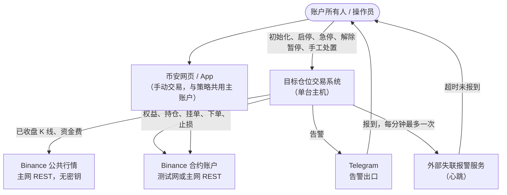
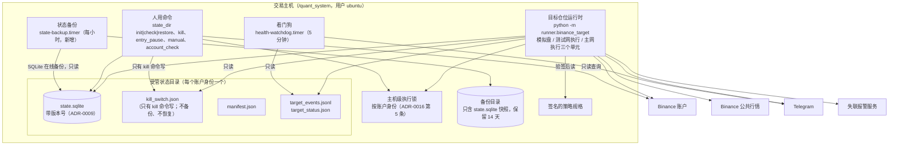
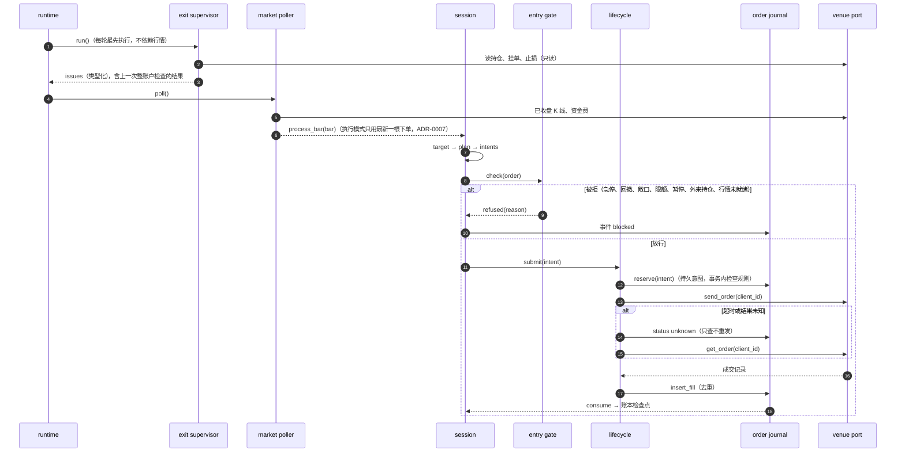
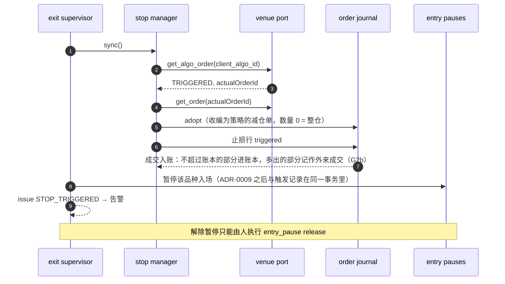
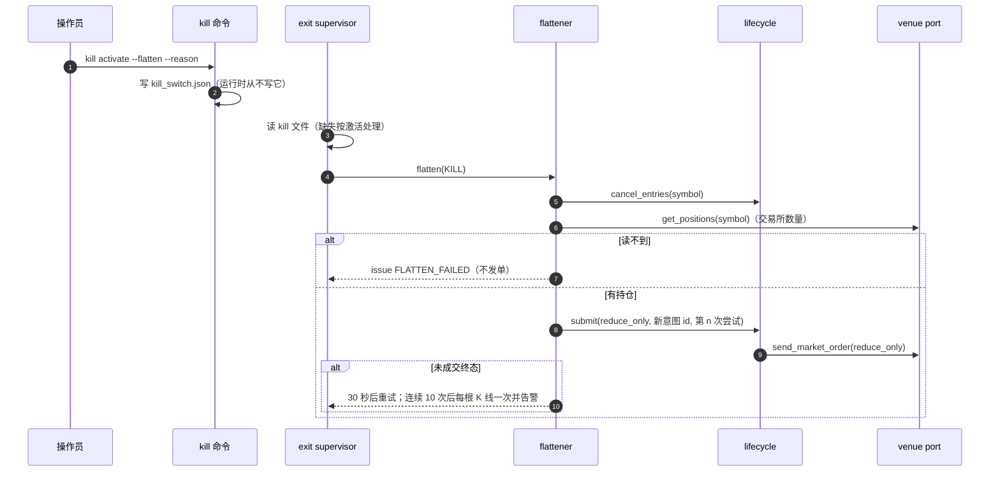

# M5 及之后的架构设计（2026-11-15）

- 性质：设计文档。写作时只读，没有改动 `trading/`、`runner/`、`lab/`、`infra/`；设计和 ADR 经技术负责人批准后作为文档提交。
- 基线：master `a2b57fb`。PR #64（ADR-0010）和死代码清理批次都已合并。
- 依据：
  - `CLAUDE.md`、`docs/arch/target.md`、`docs/arch/roadmap.md`、`docs/arch/current-state.md`；
  - `docs/adr/0001`–`0010`，以及 `docs/arch/execution-log.md` 最近几节。
  - 代码与文档冲突时以代码为准，冲突记录在 `docs/arch/doc-vs-code.md` 第 4 节。
- 证据标注：【代码 路径:行号】【实际运行结果】【测试日志】【推测】。【推测】表示没有运行验证。
- 决定的来源：本设计里"已决定"的取舍，都是技术负责人 2026-11-15 在本次评审中逐项回答的（第 0.2 节）。
- 新 ADR（0011–0017）由技术负责人 2026-11-15 全部批准（"现在全部批准"）。实施按第 10 节的顺序进行。
- 独立审计员反驳了初稿，发现和我的回应见附录 A。正文已按回应修订。

## 0. 范围与已决定的取舍

### 0.1 范围

- **在范围内**：
  - M5（测试网连续运行）需要的架构改动；
  - ADR-0006 方案 B 和运行时拆分的接口；
  - 退出侧缺口；
  - 运行就绪：告警、心跳、备份、重启、主机安装；
  - 前向候选的承载能力分析；
  - 不变量的自动检查。
- **不在范围内**：
  - 策略数学和风险阈值的数值；
  - 主网上线。主网仍由签名规格里的 `passed=false` 拒绝【代码 `runner/binance_target.py:73-74`】，本设计不改这一点。

### 0.2 技术负责人 2026-11-15 的回答

| # | 问题 | 决定 |
|---|---|---|
| A | 设计基线 | 先合并 PR #64 和删除批次，以 master 为基线 |
| B | 运行中出现不属于策略的持仓或挂单 | 检查整个账户；有发现就阻断全部入场并告警；急停和回撤平仓的口径不变，仍按交易所持仓全平 |
| C | 止损和击穿后平仓的数量 | 统一按交易所持仓（细化见 N） |
| D | 执行模式没有告警出口 | 测试网、主网一律拒绝启动；模拟盘可以只写日志 |
| E | 执行模式进程异常退出 | 测试网单元有限次自动重启；主网单元不自动重启，只告警 |
| F | 外部心跳 | 用主机之外的失联报警服务，由账户所有人注册 |
| G | 状态备份 | 本机每小时在线快照，保留 14 天；恢复由人执行；M5 期间演练一次（细化见 M） |
| H | 前向候选的运行时 | 现在只写接口和差距说明；2027-05-13 判定通过后再实现 |
| I | M5 通过标准 | 连续 4 周对账无差异、没有未解释的告警；7 类演练各至少一次并有记录；出现任何差异都从头计时 |
| J | 启动告警 | 执行模式启动时同步发一条"已启动"；没有确认送达就拒绝启动 |
| K | 心跳地址 | 执行模式必须配置，否则拒绝启动；运行中心跳失败只记日志，不影响交易和平仓 |
| L | 模拟盘里的止损（审计后） | 模拟交易所按 K 线最高价、最低价触发止损；触发后和实盘一样暂停入场；与研究的分叉记作已解释的差异；正式实施前先做可行性验证 |
| M | 备份恢复（审计后） | 只在状态库丢失或损坏时允许恢复；急停文件不备份、不恢复；恢复后当期回撤视为已锁定、当日下单计数视为用完、所有品种暂停入场，由人逐个解除 |
| N | 账本为 0、交易所有仓位（审计后） | 不挂策略止损；止损平掉的数量多于账本时，多出的部分记作外来成交、不进策略账本，并告警 |
| O | 整账户检查的频率（审计后） | 两次之间至少间隔 60 秒；上一次的结果在每一轮品种对账时都重新生效；有发现时同时撤掉策略挂着的入场单 |

## 1. 差距分析：路线图第 2 节的 6 条完成标准

| # | 完成标准 | 现在是否成立 | 证据 | 差距 | 由哪一步补齐 |
|---|---|---|---|---|---|
| 1 | 新结构完全接管：加载运行时后没有旧包和 Rust 扩展 | **不成立** | 【实际运行结果】执行 `python3 -c "import sys, runner.binance_target; print(sorted(m for m in sys.modules if m.split('.')[0] in {'data','lab','runner','infra','monitoring'}))"`，输出 `['data', 'data.quality', 'data.quality.causal_bars', 'lab', 'lab.orders', 'lab.rebalance', 'lab.simulate', 'runner', 'runner.binance_target', 'runner.offline', 'runner.offline.broker']`。Rust 扩展已在 M4 删除。来源：模拟盘用研究的 `Sleeve` 和撮合器【代码 `runner/binance_target.py:28-29`】 | 模拟盘走研究代码，入口依赖 `lab` 和 `runner.offline` | S9、S10（ADR-0013） |
| 2 | 退出可靠：急停或回撤后，仓位在可预期的时间内归零；失败会重试并告警 | **部分成立**，只有测试证明 | 【测试日志】`tests/characterization/test_exit_paths.py`、`tests/unit/trading/test_flatten.py`、`test_exit_robustness.py`、`test_stop_durability.py` 全部通过。【代码】击穿止损只平账本数量（`trading/application/execution/flatten.py:30,67`）；止损按账本定量（`trading/application/execution/stops.py:122,172`） | 止损和击穿平仓的口径与交易所不一致（第 2 节 G1、G2）；从没有在真实交易所上运行过 | S5（ADR-0012）、M5 演练 |
| 3 | 已知缺陷清零 | **不成立** | 【实际运行结果】`git grep -n 'known_defect("R' -- tests` 只有一处：`tests/characterization/test_risk_state.py:125`，即 R20 | R20 | S6（ADR-0016 第 5 条） |
| 4 | 仓库干净：每个模块要么在用，要么属于明确冻结的范围 | **成立** | 【实际运行结果】`python3 scripts/dev/import_graph.py unreachable --keep "runner/binance_target.py,trading/*,lab/*,data/quality/causal_bars.py,data/downloads/*,scripts/*,scripts/dev/*,infra/model_signing.py,monitoring/watchdog.py,monitoring/tca.py"` 只剩 `docs/arch/evidence/` 下 4 个取证脚本，共 297 行，是有意保留的 | 无 | — |
| 5 | 测试网连续运行数周，对账无差异 | **未开始** | 没有测试网运行记录 | 全部 | M5（第 6 节，第 10 节 S11） |
| 6 | 可以交接：只读 `docs/arch/` 和测试，就能说清每个模块的职责、每条不变量由哪个测试保证 | **部分成立** | 【代码】`docs/arch/target.md` 第 7 节的"现状"一列停在 2026-11-14，已修复的 L5、L6、K2–K5 仍标 ✗（见 `doc-vs-code.md` 第 4 节）。【实际运行结果】还有 14 个测试文件依赖 `tests/support/` 的旧接口。第 7 节列出了还没有自动检查的不变量 | 不变量表过时；部分不变量没有检查 | S1，以及持续进行的工作 |

## 2. 退出侧缺口：落在哪一层、哪个端口、用什么测试锁定

`CLAUDE.md` 的 "Open exit-side gaps" 一节列出的缺口，加上本次决定 B 带来的运行中检查（G5），每条都写明状态未知时怎么处理、失败时往哪个方向失败。

| # | 缺口 | 层与模块 | 端口 | 设计 | 状态未知时 | 失败方向 | 锁定用的测试（新） |
|---|---|---|---|---|---|---|---|
| G1 | 止损跟账本，不跟交易所持仓【代码 `stops.py:122`：数量和入场价取自账本检查点；`stops.py:172`：方向不一致就不挂】 | 应用层 `execution/stops.py` | `ExchangeAccount.get_positions`、`StopOrderGateway` | 决定 C、N（详见 ADR-0012）：<br/>• 账本不为 0、交易所同方向：止损覆盖交易所全部持仓，触发价按交易所入场价算，止损单类型不变（整仓平仓）【代码 `adapter.py:364`】；<br/>• 账本为 0：不挂策略止损；<br/>• 账本不为 0，但交易所为平、方向相反，或者请求的品种查不到：保留已有的有效止损，不新挂、不撤，记问题并阻断入场；<br/>• 止损修订号由规范化（按步长、价格精度取整）后的数量和入场价派生 | 读不到交易所持仓：保留已有止损，不新挂、不撤，阻断入场 | 关闭：不确定时保留现有保护，并阻断新敞口 | 账本 0.1、交易所 0.15：触发价按交易所入场价；账本 0、交易所 0.1：不挂止损；账本 0.1、交易所为平或方向相反：已有止损不被撤销；交易所读失败：已有止损不被撤销 |
| G2 | 击穿止损后只平账本数量【代码 `flatten.py:30,67`】 | 应用层 `execution/flatten.py` | `ExchangeAccount.get_positions` | 决定 C：把 `stop_breached` 加入按交易所持仓全平的集合，与急停、回撤相同 | 读不到交易所持仓：不发单，记问题，按 1b 的节奏重试 | 关闭：没有数量就不发单 | 交易所 0.15、账本 0.1 时击穿平仓平 0.15；读持仓失败时不发单 |
| G2b | 止损（或按交易所全平）平掉的数量多于账本时，成交会被收编进策略账本，造成一笔不存在的反向仓位（审计 M3；现状下交易所大于账本时就会发生） | 应用层 `execution/stops.py` 收编，`execution/fills.py` 入账 | `OrderJournal` | 决定 N：收编的成交只按账本数量入账，多出的部分记作外来成交（订单库里单独记录、不进入策略检查点），并发出 `FOREIGN_FILL` 问题 | 账本读不出：整笔成交不入账、保留在待消费状态，入场阻断 | 关闭 | 账本 0.1、止损成交 0.15：账本归 0，外来成交 0.05 有记录和告警 |
| G3 | 止损挂不上时阻断入场，持续 2 分钟后告警 | 已经实现（第 12 步） | — | 不变；告警真的能送达靠 G4 | — | — | 现有：`tests/characterization/test_stops_and_fills.py::test_a_position_without_a_working_stop_blocks_entries_until_one_is_in_place` |
| G4 | 没配 Telegram 时告警只写日志【代码 `trading/infrastructure/settings.py:73-82`】 | 组装层的启动检查；`Notifier` 端口新增一个确认送达的方法 | `Notifier.deliver(...) -> bool`（新） | 决定 D、J：<br/>• 执行模式两个变量都必须配置；<br/>• 本地检查通过之后、连接账户之前，同步发送"执行模式正在启动"，没有收到确认就拒绝启动；<br/>• 账户检查（ADR-0010）若拒绝启动，再发一条"拒绝启动：原因"；<br/>• 现有的发送方法会吞掉失败【代码 `trading/adapters/notify/telegram.py:73-81`】，所以要新增方法 | 发送超时按没送达处理 | 关闭：拒绝启动，而且没有发出任何账户请求 | 执行模式缺配置时拒绝启动，账户请求数为 0；发送失败时拒绝启动，账户请求数为 0；模拟盘缺配置照常启动 |
| G5 | 运行中出现外来持仓或挂单（ADR-0010 只在启动时检查） | 应用层：退出监督者调用 `account_ownership.foreign_holdings` | `AccountSnapshot` | 决定 B、O（详见 ADR-0011）：<br/>• 整账户检查两次之间至少间隔 60 秒；<br/>• 上一次的结果在每一轮品种对账时都重新生效，所以阻断不会在两次检查之间消失；<br/>• 有发现时阻断全部品种的入场，撤掉策略挂着的入场单，并告警；<br/>• 急停、回撤平仓的口径不变 | 读不到账户：同样阻断全部入场 | 关闭 | 发现后的 60 秒里，每轮对账之后入场都仍被阻断；挂着的入场单被撤；读失败时阻断；发现消失后解除 |
| G6 | 没有模拟盘与回放的对比工具 | 组装层命令行，加研究侧 | `EventLog`、`PaperStore` | 新命令把一段时间的模拟盘成交与同一段 K 线上的研究模拟逐笔比较，输出第一处差异；已解释的分叉（第 4.3 节）单独列出 | 数据缺失时报"无法比较"，不报"一致" | 关闭：不确定就不算通过 | 一致的样例输出"一致"；注入一处差异能报出来；缺数据时不报一致 |

说明：

- G1、G2、G2b 改变风控行为，按 ADR-0012实施。
- 这三条依赖 ADR-0010 的启动检查和 G5 的运行中检查：正常情况下账本与交易所一致，改口径不改变结果；不一致时入场已经被阻断，止损和平仓覆盖交易所上同方向的全部持仓。决定 C 接受了这个代价：同品种、同方向的手动仓位也会被平掉。
- G5 与 ADR-0005 3b 的关系：3b 的前提是"账户专用"，G5 在运行中持续检查这个前提。发现外来持仓时不改变平仓口径，只阻断入场并告警，由人处理。

## 3. 目标结构

### 3.1 C4 第一层：系统上下文



### 3.2 C4 第二层：容器



### 3.3 订单时序图

**(a) 执行模式每小时的入场**



**(b) 运行中交易所侧止损触发**



**(c) 急停平仓**



## 4. ADR-0006 方案 B 与运行时拆分：模块边界和接口草案

取舍见 ADR-0013。审计（附录 A，H1、H2）证明：初稿里"模拟盘和执行唯一的区别是注入的交易所适配器"做不到。下面把必须保留的模式差异逐条列出来，每一条都写进组装根，并有测试固定。

### 4.1 模块边界

```
trading/
  adapters/simulated/
    bar_broker.py        研究撮合器，从 runner/offline/broker.py 原样搬入（研究和模拟盘共用）
    exchange.py          SimulatedExchange：账户、下单、止损、整账户快照、K 线监听五个端口
  application/
    runtime.py           TargetRuntime：每轮的顺序编排
    market_poller.py     预热、轮询、退避、行情问题；按模式执行补放策略
    exit_supervisor.py   对账、整账户检查、暂停、止损同步、急停/回撤/击穿平仓
    status.py            状态快照
    issues.py            Issue、IssueKind、Effect（ADR-0014）
    symbol_state.py      每个品种的状态机（ADR-0014）
  infrastructure/
    config.py            启动时读一次环境变量，得到不可变的 RuntimeConfig（ADR-0017）
    modes.py             模拟盘与执行的全部差异集中在这里（ModePolicy）
    bootstrap.py         组装根
    cli/target.py        入口参数解析；runner/binance_target.py 变成转发薄壳
```

### 4.2 接口签名草案

```python
# trading/application/ports.py（新增）
class BarListener(Protocol):
    """模拟交易所在每根已收盘 K 线上撮合；执行模式没有监听者。"""
    def on_closed_bar(self, symbol: str, bar: Bar, funding_rate: Decimal | None) -> None: ...

class Notifier(Protocol):          # 现有端口加一个方法
    def alert(self, level: str, title: str, detail: str = "") -> None: ...
    def deliver(self, title: str, detail: str, *, timeout_s: float) -> bool: ...   # 同步，确认送达才返回 True

class Heartbeat(Protocol):
    def beat(self) -> None: ...        # 失败只记日志，从不抛出

# trading/infrastructure/modes.py
@dataclass(frozen=True)
class ModePolicy:
    catch_up: Literal["replay_all", "latest_only"]       # 模拟盘逐根补放；执行只用最新一根（ADR-0007 补充批准）
    entry_ttl: Literal["venue", "lifecycle"]            # 模拟盘由撮合器按 K 线过期；执行由生命周期按时间过期
    sizing_equity: Literal["per_symbol_venue", "account_share"]   # 模拟盘用每个品种模拟账户自己的权益（与研究相同）
    limiter_clock: Literal["bar_time", "monotonic"]     # 模拟盘的每秒限额按 K 线时间计
    settle_new_bar_before_decision: bool                # 模拟盘：撮合 → 消费成交 → 决策

# trading/adapters/simulated/exchange.py
class SimulatedExchange:   # ExchangeAccount、OrderGateway、StopOrderGateway、AccountSnapshot、BarListener
    def __init__(self, brokers: Mapping[str, BarBroker], *, filters: Mapping[str, SymbolFilters],
                 stop_model: StopModel, clock: Clock) -> None: ...
    def on_closed_bar(self, symbol: str, bar: Bar, funding_rate: Decimal | None) -> None: ...
    def filters(self, symbol: str) -> SymbolFilters: ...
    def get_ticker(self, symbol: str) -> Ticker: ...
    def get_account_equity(self) -> float: ...
    def get_symbol_equity(self, symbol: str) -> Decimal: ...           # 供 per_symbol_venue 定仓
    def get_positions(self, symbol: str = "", *, strict: bool = True) -> tuple[VenuePosition, ...]: ...
    def get_open_orders(self, symbol: str = "", *, strict: bool = True) -> tuple[OpenOrder, ...]: ...
    def send_market_order(...) -> Placement: ...
    def send_limit_order(...) -> Placement: ...
    def get_order(...) -> VenueOrder | None: ...
    def get_recent_fills(...) -> tuple[CanonicalFill, ...]: ...
    def cancel_order(self, symbol: str, order_id: str) -> dict[str, Any]: ...
    def place_stop_market(self, symbol: str, side: str, trigger_price: Decimal, *, client_algo_id: str) -> Placement: ...
    def get_algo_order(self, *, client_algo_id: str) -> StopOrder | None: ...
    def get_open_algo_orders(self) -> tuple[StopOrder, ...]: ...
    def get_symbol_settings(self, symbol: str) -> tuple[int, str]: ...
    def snapshot(self) -> dict[str, Any]: ...
    def restore(self, state: Mapping[str, Any]) -> None: ...

class StopModel(Protocol):         # 决定 L：按 K 线最高价、最低价触发；触发价成交加止损滑点
    def triggered(self, side: str, trigger: Decimal, bar: Bar) -> Decimal | None: ...

# trading/application/market_poller.py
class MarketPoller:
    def __init__(self, market: MarketData, sessions: Mapping[str, TargetSession], *, policy: ModePolicy,
                 listeners: Sequence[BarListener], clock: Clock, events: EventLog) -> None: ...
    def warmup(self) -> WarmupResult: ...
    def poll(self) -> PollResult: ...

# trading/application/exit_supervisor.py
class ExitSupervisor:
    def __init__(self, sessions: Mapping[str, TargetSession], *, account: AccountSnapshot, journal: OrderJournal,
                 kill: KillSwitch, drawdown: DrawdownGuard, pauses: EntryPauses, config: ExitConfig,
                 clock: Clock, events: EventLog) -> None: ...
    def run(self) -> list[Issue]: ...   # 对账（重新施加整账户检查结果）→ 整账户检查（到期时）→ 暂停 → 止损 → 急停/回撤/击穿
    def settle(self, symbol: str) -> list[Issue]: ...   # 模拟盘新 K 线撮合后、决策前：消费成交、处理到期

# trading/application/runtime.py
class TargetRuntime:
    def cycle(self) -> RuntimeStatus:
        """执行模式：ExitSupervisor.run() → MarketPoller.poll() → 会话 → 状态。
        模拟盘每根新 K 线：MarketPoller 取到 K 线 → listener 撮合 → ExitSupervisor.settle(symbol) → 会话决策。
        两种模式下，退出侧都在每轮开始先执行一次。"""
```

### 4.3 必须保留的模式差异、验收和已知障碍

| 差异 | 原因 | 证据 |
|---|---|---|
| 补放策略：模拟盘逐根补放，执行只用最新一根 | ADR-0007 的补充批准（执行模式行情恢复后只用最新一根决策）；模拟盘的重启测试依赖逐根补放 | 【代码 `trading/application/runtime.py:83,282-285`】；【测试日志】`tests/unit/lab/test_target_runtime_resilience.py:213` 固定执行模式的行为 |
| 限价入场单的过期由谁负责 | 研究里限价单在一根 K 线撮合之后才过期【代码 `runner/offline/broker.py:246`】；生命周期按秒计时，会在撮合那根 K 线之前把它撤掉（审计 H1-1） | 【代码 `trading/application/execution/lifecycle.py:293-302`、`trading/infrastructure/target.py:150`】 |
| 定仓用的权益 | 研究每个品种的模拟账户用自己的权益【代码 `lab/simulate.py` 的 `decide`】；执行用账户权益乘以 1/品种数【代码 `trading/application/session.py:142`、`trading/infrastructure/target.py:152`】。审计员在验收样例上测到两者最多差 14.99 USDT | 【实际运行结果，审计员的探针】 |
| 新 K 线的处理顺序 | 研究先撮合这根 K 线，再按撮合后的仓位决策；执行在对账时才消费成交（审计 H1-4） | 【代码 `trading/application/runtime.py:133`、`session.py:135,255-256`】 |
| 每秒限额的时钟 | 限额器用真实的单调时钟【代码 `trading/infrastructure/target.py:140-142`】；在模拟时间下，两个品种同一轮下单会让第二个被推迟，再因"处理过晚"被丢掉（审计 H1-5，验收样例里有 6 根 K 线出现这种情况） | 【实际运行结果，审计员的探针】 |
| 止损 | 研究没有止损；研究撮合器在概览策略的配置下不能挂止损（审计 H1-2，实测 `set_stop` 抛错）。决定 L：模拟交易所用 `StopModel` 按 K 线最高价、最低价触发 | 【实际运行结果，审计员的探针】 |

- **验收门（不改断言）**：
  - `tests/unit/lab/test_target_runtime.py::test_paper_runtime_reproduces_lab_simulation`，所有参数化组合，包括 `("maker", 1)`；
  - `tests/unit/lab/test_target_runtime_resilience.py` 的三条重启测试（第 68、172、192 行）；
  - `tests/unit/lab/test_simulation_golden.py` 的两个指纹。
- **有意的分叉**：入场门和止损在模拟盘里生效，研究里没有。每次分叉都写一条 `paper_divergence` 事件，记下原因：入场门拒绝、止损触发、暂停。对比工具（G6）把它们列为"已解释的差异"。验收样例里的止损距离保证不会触发，所以验收门不受影响。
- **模拟盘的安全**（审计 M6）：
  - 模拟盘组装时不构造任何带凭据的适配器；
  - 不发出任何签名请求；
  - 不读账户相关的环境变量。
  - 这三点要有测试。
- **可行性先验证**（决定 L）：S9 在一个丢弃型分支上实现到验收门能跑的程度，用审计员的探针加验收门判断可不可行，再由技术负责人决定是否正式实施（S10）。
- **前向记录**：模拟盘现在没有部署（2026-11-14 决定），前向判定只看登记查看日的回放，所以切换不影响前向证据。切换日期写入执行记录。

## 5. 承载能力：三个前向候选能否执行

| 候选 | 形态【代码 `research/results/forward_candidates_2026-11-14/*.json`】 | 现在的会话、再平衡、订单意图能否表达 | 缺什么 |
|---|---|---|---|
| A `pair_ridge_pd_7d` | ETH/BTC 配对，每 7 天决策方向；19 个价格和衍生品特征；资本 10,000 | 不能。会话是一个品种一个【代码 `trading/application/session.py:73-105`】；两条腿各自按带宽再平衡会漂移 | ① 两条腿协调：同一次决策同时生成两条意图，并规定一条腿失败时怎么办；② 配对级回撤（协议上限 60%）；③ 配对级止损，或"一条腿被止损后另一条腿怎么办"的规则；④ 衍生品行情：资金费、溢价、持仓量、主动买卖量；⑤ 前向协议明确要求新的两条腿运行时【代码 `research/protocols/2026-11-14-forward-candidates.md:129`】 |
| B `dir_ridge_7d` | 单品种方向，每 7 天决策；15 个特征；按波动定仓 | 下单部分可以：目标权重可以为负，再平衡支持空头和换向【代码 `trading/domain/rebalance.py:47-52`】 | ① 策略不可插拔：会话写死了 `latest_target`【代码 `session.py:103-105`】，入口只认一种规格【代码 `runner/binance_target.py:61`】；② 衍生品特征需要的行情端口；③ 每 7 天决策一次的节拍（现在每根 K 线都重新计算目标） |
| C `flush_reversal_72h` | 爆仓后只做多，持有 72 小时；事件分位数的窗口是 8,760 小时 | 下单部分可以：只做多、按波动定仓、带宽 0.1 | ① 策略可插拔；② 持仓量等指标的历史：分位数窗口 1 年、最少 4,320 小时，而交易所的持仓量历史接口只保留最近一段【推测：约 30 天，没有运行验证】，所以运行时需要本地指标存储和增量下载；③ 事件状态（持有到什么时候）要跨重启保存 |
| 多个候选同时运行 | — | 不能 | Binance 单向持仓模式下，一个品种只有一个净持仓。两个策略在同一品种上会互相抵消；整仓平仓的止损和按交易所全平的急停会同时影响两者。需要组合层把各策略的目标合成每个品种的一个目标，再加上组合级的敞口和回撤 |

决定 H：现在只写接口（ADR-0015），判定通过后再实现。这不影响 M5。

## 6. M5 运行就绪

| 项 | 现状 | 设计 | 状态未知、失败时 |
|---|---|---|---|
| 告警出口（D、J） | 两个变量都不设时只写日志【代码 `settings.py:73-82`】；发送失败被吞掉【代码 `telegram.py:73-81`】 | 执行模式缺任一个变量就拒绝启动；本地检查通过后、连接账户前，用 `Notifier.deliver` 同步发送"正在启动"，确认送达才继续 | 超时或失败：拒绝启动，不发出任何账户请求（关闭）。模拟盘不变 |
| 外部心跳（F、K） | 没有。看门狗与运行时在同一台主机上【代码 `infra/systemd/health-watchdog.timer`】 | `Heartbeat.beat()`：每分钟最多一次，在后台发送、带超时；预热和等待行情期间也照常发送（审计 L6）；执行模式没配地址就拒绝启动；心跳地址在配置日志里按密钥处理 | 运行中发送失败只记日志，不阻断交易和平仓。心跳只是旁观者，失败时放行 |
| 状态备份（G、M） | 没有 | • `state-backup.timer` 每小时用 SQLite 在线备份接口给 `state.sqlite` 拍快照，校验能打开、版本号对、表齐全，保留 14 天，失败时告警；<br/>• 急停文件不备份、不恢复；<br/>• `state_dir restore` 只在状态库丢失或损坏时允许，要求运行时已停止（拿得到同一把主机锁）、写明理由、键入确认，并留审计记录；<br/>• 恢复后当期回撤锁定、当日下单计数视为用完、所有品种暂停入场，由人逐个解除 | 备份失败不影响运行时。恢复只会收紧：急停保持原样；与交易所的不一致由 ADR-0010 拒绝启动 |
| 重启策略（E） | 唯一的服务单元带 `Restart=on-failure`、`RestartSec=60`，而且是 `--dry-run`【代码 `infra/systemd/binance-target.service:16-18`】 | 三个单元：<br/>• 模拟盘：保持现状；<br/>• 测试网执行：`[Service] Restart=on-failure`，`[Unit] StartLimitIntervalSec=3600`、`StartLimitBurst=3`、`OnFailure=` 告警单元；<br/>• 主网执行：`Restart=no`、`OnFailure=` 告警。<br/>说明（审计 L1）：<br/>• `OnFailure=` 在每次失败时都触发，包括随后被自动重启的那次；<br/>• `StartLimitBurst` 把人手动启动也算进去，演练前后要执行 `systemctl reset-failed`；运行手册写明 | 主网异常退出后，交易所侧止损仍然有效；人确认后手动启动，启动检查重新核对一切 |
| 主机安装 | 没有脚本；检出目录写死为 `/quant_system`（`CLAUDE.md`）；`.env.example` 已过时，还列着 Bybit、OKX，缺 `RISK_SCOPE`、`BINANCE_TESTNET` | `infra/install_host.sh`：幂等，不读密钥；按 `requirements/container.lock` 带哈希安装；同步 systemd 单元、部署日志轮转；装完运行 `scripts/check_local_safety.py`。重写 `.env.example`；主机锁目录由 `state_dir init` 创建（由人执行） | 任何一步失败就退出，不启动服务 |
| 配置只读一次 | 启动阶段和命令行工具里共 18 处调用配置读取函数【实际运行结果，按调用处统计】；运行循环里没有。没有一份记录"这次用了什么配置" | `RuntimeConfig`：启动时读一次，写进日志（不含密钥和心跳地址），之后只传这个对象 | 配置不合法：拒绝启动 |

**M5 通过标准（决定 I）**：

- 连续 4 周：对账无差异，没有未解释的告警。
- 下面 7 类演练各至少一次，每次在执行记录里写明时间、操作、预期和实际：
  1. 急停平仓；
  2. 回撤锁定；
  3. 交易所侧止损触发；
  4. 进程重启恢复（包括有未决订单的情况）；
  5. 备份恢复；
  6. 告警送达；
  7. 心跳失联。
- 出现任何对账差异或未解释的告警，都从头计时。
- 往测试网主机部署资金路径上的代码改动，也从头计时。所以方案 B（S10）要么在计时开始之前合并，要么等 M5 通过之后再合并。

## 7. 不变量与自动检查

`target.md` 第 7 节的表已经过时（见 `doc-vs-code.md` 第 4 节）。下表是本设计核对后的完整现状，S1 用它替换旧表。

| 不变量 | 现在的自动检查 | 状态 |
|---|---|---|
| L1 3 倍上限只定义一次 | 【测试日志】`tests/architecture/test_rules.py::test_the_hard_leverage_cap_is_defined_once` | 有 |
| L2 每张入场单都经过入场门 | 【测试日志】`tests/characterization/test_runtime_decisions.py::test_the_entry_gate_as_the_runtime_assembles_it`；但模拟盘路径绕过入场门【代码 `session.py:173-175`】 | 部分（S10 之后成立） |
| L3 执行模式入场门的四个组件缺一不可 | 【测试日志】`tests/unit/trading/test_domain_risk.py` | 有 |
| L4 权益、持仓、状态库任何一项未知时拒绝入场 | 【测试日志】`tests/unit/trading/test_unknown_equity.py`、`tests/unit/trading/test_lost_state_files.py` | 有 |
| L5 回撤锁定和当日计数在重启后保持 | 【测试日志】`test_risk_state.py::test_drawdown_latch_survives_a_restart_with_the_same_file_and_scope`、`::test_the_daily_order_count_survives_a_restart` | 有 |
| L6 检查通过之前不写账户 | 【测试日志】`test_risk_state.py::test_the_mainnet_gate_refuses_before_any_account_setting_is_written` 等 3 条；ADR-0010 之后，连接账户本身也是只读的 | 有 |
| L7 没有自动提高上限的路径 | 回撤上限有硬顶，并有测试；还没有"配置对象不可变、启动后不再读配置"的架构测试 | 部分（S4） |
| K1 急停激活后没有新的入场 | 【测试日志】`tests/unit/trading/test_exit_robustness.py`、`test_exit_paths.py` | 有 |
| K2–K5 急停先撤后平；命令和运行时用同一个文件；运行时只读；没有止损就阻断 | 【测试日志】`test_exit_paths.py::test_kill_flatten_cancels_a_resting_entry_first_then_closes_the_position`、`test_state_dir.py::test_the_runtime_reads_the_kill_file_the_command_writes`、`::test_only_the_kill_command_writes_a_kill_file`、`test_stops_and_fills.py::test_a_position_without_a_working_stop_blocks_entries_until_one_is_in_place` | 有。K4 只能发现带 `active=` 参数的写调用，发现不了复制文件（审计 M1），S8 补 |
| K6 急停文件损坏或不可读按激活处理 | 【测试日志】`test_state_dir.py::test_in_a_managed_directory_a_kill_file_that_disappears_reads_as_active` | 有 |
| F1–F4 无前视 | 【测试日志】`tests/unit/trading/test_strategy_causality.py`、`tests/unit/lab/test_lab_engine.py::test_targets_are_causal`、`tests/unit/binance/test_binance_adapter.py::test_klines_closed_only_and_ascending`、`tests/unit/data/test_causal_bars.py` | 有 |
| F5 前向窗口只在登记的查看里读取 | `lab/forward.py` 的拒绝逻辑有测试；数据加载函数没有日期上限 | 部分 |
| O1 同一意图至多提交一次；O4 只有交易所成交才入账、恰好一次 | 【测试日志】`tests/offline/test_execution_safety.py`、`tests/characterization/test_order_facts.py` | 有 |
| O2 状态只能按转移表变化 | 【测试日志】`test_order_transitions.py` 固定了转移表；生产中只记录、不拒绝（ADR-0004，M5 之后再定） | 部分 |
| O3 订单表只有一个写入者 | 【测试日志】`tests/architecture/test_rules.py::test_sqlite_is_imported_only_by_the_sqlite_adapters` | 有 |
| O5 崩溃重启不重复下单、不丢成交 | 【测试日志】`tests/offline/test_execution_recovery.py`、`test_target_runtime_resilience.py::test_paper_restart_while_orders_are_pending_reproduces_lab_simulation`、`test_startup_account_check.py` 的恢复类测试 | 有 |
| O6 减仓被拒绝时记日志 | 【测试日志】`test_flatten.py::test_a_reduction_refused_by_the_order_journal_is_logged_with_its_reason` | 有 |
| P1 模拟盘与研究逐笔相同 | 【测试日志】`test_target_runtime.py::test_paper_runtime_reproduces_lab_simulation` 等 | 有（S10 面临的主要风险） |
| P2 模拟盘与执行用同一份会话代码 | 没有 | **没有**（S10） |
| P3 模拟盘状态跨重启连续 | 【测试日志】`test_target_runtime_resilience.py` | 有 |
| P4 研究与实盘共用的参数只有一个来源 | 限价偏移写了三份【代码 `lab/simulate.py:39`、`runner/offline/broker.py:38`、`trading/infrastructure/target.py:48`】 | **没有**（S10） |
| S1 依赖只能向内，核心层不做 I/O | `.importlinter` 5 条契约，加 `tests/architecture/test_rules.py` | 有 |
| S2 资金相关测试都在 CI 门禁里 | 【测试日志】`test_rules.py::test_money_path_tests_are_gated_in_ci_and_make`、`::test_the_ci_shards_together_are_the_whole_suite` | 有 |
| T1 测试从不联网 | 没有任何 `conftest` 屏蔽网络【实际运行结果：`grep -rn socket tests/conftest.py` 无结果】 | **没有**（S1） |
| T2 策略规格和模型只经签名校验加载 | 只有签名模块自身的单元测试 | **没有**（S1） |
| T3 主网执行单元不自动重启 | 没有 | **没有**（S8） |
| T4 运行中出现外来持仓就阻断入场，而且阻断持续到外来持仓消失 | 没有（G5 还没实现） | **没有**（S5） |
| T5 执行模式没有告警出口、启动告警没送达、没有心跳地址时不能启动 | 没有 | **没有**（S7） |
| T6 启动之后不再读配置；配置日志里不含密钥和心跳地址 | 只有"只有组装层读环境变量"这一条 | **没有**（S4） |
| T7 一个账户身份同时只有一个执行进程；运行时在跑时，手工工具和恢复命令拒绝执行 | 已知缺陷测试固定了现状（R20）；手工工具按状态目录的租约拒绝 | **不成立**（S6） |
| T8 恢复只收紧、不放宽风险状态 | 没有 | **没有**（S8） |
| T9 心跳失败不影响平仓和对账 | 没有 | **没有**（S7） |
| T10 模拟盘不构造带凭据的适配器、不发签名请求 | 没有 | **没有**（S10） |

## 8. 取舍与备选方案

| # | 主题 | 采用 | 备选 | 理由 |
|---|---|---|---|---|
| T1 | 止损定量（G1） | 账本不为 0 且同方向时按交易所持仓；账本为 0 不挂（决定 C、N） | 按账本定量，差异只告警 | 止损单本来就是整仓平仓，按账本挂会给人"只平自己那部分"的错觉；账本为 0 时挂止损会把外来仓位收编进账本 |
| T2 | 运行中外来持仓（G5） | 阻断全部入场、撤掉挂着的入场单、告警（决定 B、O） | 紧急平仓只平账本；运行中不查 | 共用账户时，"账户专用"这个前提要持续检查 |
| T3 | 整账户检查的频率 | 至少间隔 60 秒，结果每轮重新施加（决定 O） | 每 5 秒全查 | 【推测】按币安公布的权重，不带品种查挂单是 40，条件单列表可能也是 40；每 5 秒全查约每分钟 350–450，再加上现有的负载。代码自己的限频表把这两个接口都算成 1【代码 `trading/adapters/binance/rate_limit.py:13-27`】，低估了；S5 改正这张表 |
| T4 | 方案 B 的撮合器 | 包装研究撮合器，模式差异集中写在 `ModePolicy` 里 | 重写撮合器；暂缓方案 B | 逐笔一致是硬门，共用同一个撮合器最容易保持；先做可行性验证（决定 L） |
| T5 | 运行时拆分 | 按职责拆成行情、退出、状态三块，退出每轮最先执行 | 维持一个类 | ADR-0007 4b 要求退出侧不依赖行情 |
| T6 | 类型化的问题 | 问题带类型和后果，品种状态由转移表决定 | 继续用字符串 | 现在靠在文字里找 `"stop_breached"` 决定平仓【代码 `runtime.py:142`】 |
| T7 | R20 | 主机级锁，按账户身份（API Key 的哈希加网络）加锁；手工工具和恢复命令用同一把锁 | 在交易所侧做标记 | 同一台主机上能事前阻止；只按 `RISK_SCOPE` 加锁时，两个身份用同一把 Key 仍能并行（审计 M5） |
| T8 | 心跳失败时 | 放行（只记日志） | 失败就停止交易 | 心跳是旁观者 |
| T9 | 启动告警 | 连接账户之前同步确认送达（决定 J） | 只记日志 | "配了"不等于"能送达"；放在账户请求之前，才符合"拒绝时不碰账户" |
| T10 | 备份恢复 | 只在丢失时用，恢复后一律收紧（决定 M） | 取更严的一方；原样恢复 | 原样恢复会放宽风险状态（审计 M1） |
| T11 | 多策略承载 | 只写接口（决定 H） | 现在实现 | 判定之前做，等于为可能不会上线的策略付工程成本 |

## 9. 风险表

| 风险 | 可能性 | 影响 | 对策 |
|---|---|---|---|
| 方案 B 无法保持模拟盘与研究逐笔一致 | **高**（审计 H1 已经找出 6 处具体障碍） | 高：失去"纸面 = 研究"的保证 | 模式差异集中写在 `ModePolicy` 里；先做可行性验证（S9），由技术负责人决定是否正式实施 |
| 按交易所持仓挂止损后，同品种同方向的手动仓位被平掉 | 中（共用主账户） | 中 | 决定 C 已接受；G5 告警；运行手册写明 |
| 止损平掉的数量多于账本，造成虚假仓位 | 中（现在就可能发生） | 高 | G2b：多出的部分记作外来成交 |
| 整账户检查增加请求量，导致限频 | 低 | 中 | 至少间隔 60 秒；改正限频表；限频错误按读失败处理（阻断入场，不影响平仓） |
| 启动告警依赖 Telegram 可用 | 低 | 中：无法启动执行模式 | 决定 J 已接受；模拟盘不受影响 |
| 恢复备份后风险状态被放宽 | 中 | 高 | 决定 M：恢复后一律收紧，急停文件不恢复 |
| 测试网与主网的接口行为有差异 | 中 | 中 | M5 核对清单逐项记录：条件单列表的返回格式和权重、成交查询同时带两个参数、已触发止损是否出现在挂单列表里 |
| 前向候选通过后，多腿运行时的工作量超出预期 | 中 | 中 | ADR-0015 提前写清差距，判定后再估算 |

## 10. 实施步骤

每一步一个 PR，内含多次小提交。
- "完整"指资金路径的流程：先写测试、变异自检、详细记录、里程碑审计。
- "轻"指删除、文档、工具和只改测试的改动。
- 顺序已经按依赖关系排好（审计 M7）：类型化问题在使用它的步骤之前；身份定义在主机锁之前；锁目录由初始化命令创建。

| 步 | 内容 | ADR | 流程 | 依赖 | 验收用的测试 |
|---|---|---|---|---|---|
| S1 | 不变量表换成第 7 节；测试屏蔽网络（`conftest` 禁止建立网络连接）；架构测试"规格只经签名模块加载" | — | 轻 | — | 新架构测试在注入违规时失败；全量测试在屏蔽网络时通过 |
| S2 | 状态库合并 | ADR-0009（已定） | 完整 | — | ADR-0009 的验收清单 |
| S3 | 类型化的问题与品种状态机；运行时拆成行情、退出、状态三块（不含模拟交易所） | ADR-0014，ADR-0013 第 4 条 | 完整 | S2 | 交易行为里不再有字符串匹配（架构测试）；状态转移表逐条测试；"行情全断时退出照常"的测试；现有运行时测试的断言不变 |
| S4 | `RuntimeConfig` 一次读取并记录；定义账户身份；入口变薄 | ADR-0017 | 完整 | — | 架构测试：启动后不读环境变量；配置日志不含密钥和心跳地址；同一组环境变量得到同一个摘要 |
| S5 | 运行中整账户检查（G5）；止损和击穿平仓按交易所持仓（G1、G2）；多出的止损成交记作外来成交（G2b）；改正限频表 | ADR-0011、0012 | 完整 | S3 | 第 2 节 G1、G2、G2b、G5 列出的测试；变异自检覆盖口径、失败方向，以及"阻断在两次检查之间不消失" |
| S6 | R20：主机级锁，按账户身份；手工工具和恢复命令用同一把锁；锁目录由 `state_dir init` 创建 | ADR-0016 第 5 条 | 完整 | S4 | 已知缺陷测试改为断言"同一身份的第二个进程被拒绝"；两个 `RISK_SCOPE` 用同一把 Key 时被拒绝；运行时在跑时手工工具拒绝；锁目录不可写时拒绝启动 |
| S7 | 告警出口、启动告警、心跳的启动要求 | ADR-0016 第 1–3 条 | 完整 | S4 | G4 的测试；心跳失败不影响平仓；预热期间也发心跳 |
| S8 | 服务单元（测试网、主网）；备份定时器；恢复命令；主机安装脚本；重写 `.env.example` | ADR-0016 第 4、6 条，ADR-0017 | **完整**（审计 M7：涉及执行单元的重启策略和恢复后的风险状态） | S2、S6 | 主网单元是 `Restart=no`，测试网单元的 `StartLimit*` 写在 `[Unit]` 里；恢复不放宽急停、回撤、计数，恢复后所有品种暂停；运行时在跑时恢复命令拒绝；安装脚本在干净容器里跑一次 |
| S9 | 方案 B 可行性验证（丢弃型分支）：模拟交易所、`ModePolicy`、止损模型，跑到验收门 | ADR-0013 | 验证，不合并 | S3 | 第 4.3 节的验收门；审计员的探针（限价单过期、权益、限额时钟） |
| S10 | 方案 B 正式实施（技术负责人根据 S9 决定）；撮合器搬进 `trading/adapters/simulated`；共用参数只定义一次 | ADR-0013 | 完整 | S9 | 第 4.3 节的验收门不改断言；入口不加载 `lab`、`runner.offline`（完成标准 1）；模拟盘不构造带凭据的适配器、不发签名请求 |
| S11 | 对比工具（G6）；M5 运行手册和核对清单；开始 4 周计时 | — | 轻 | S5–S8 | 对比工具的三条测试；演练记录模板 |

M5 的 4 周计时在 S5–S8 合并后开始。S10 要么在计时开始之前合并，要么等 M5 通过以后再合并（第 6 节）。

## 附录 A：审计员的反驳与回应

审计员在自己的副本里对照 master `a2b57fb` 审查初稿，用了约 40 分钟，没有改动主检出目录。

| # | 级别 | 发现 | 回应 |
|---|---|---|---|
| H1 | 高 | 初稿的 ADR-0013 保持不了模拟盘与研究逐笔一致，有 6 处具体障碍：<br/>① 限价单过期发生在撮合那根 K 线之前，`("maker", 1)` 的模拟盘限价单永远成交不了；<br/>② 研究撮合器在概览策略的配置下挂不了止损（实测 `set_stop` 抛错），没有止损会阻断模拟盘的全部入场；<br/>③ 定仓权益不同（实测最多差 14.99 USDT）；<br/>④ 决策时用的是成交前的账本；<br/>⑤ 每秒限额用真实时钟，验收样例里有 6 根 K 线会让第二个品种被推迟后丢掉；<br/>⑥ 签名草案里少了 `filters`、`get_ticker` | **接受。**<br/>• 删掉"唯一的区别是适配器"的说法，改为把必须保留的差异逐条列出（第 4.3 节），集中写在 `ModePolicy` 里；<br/>• 止损按决定 L：模拟交易所按 K 线最高价、最低价触发；<br/>• 补上缺的方法；<br/>• 风险的可能性改为"高"；<br/>• 新增 S9 可行性验证，由技术负责人决定是否正式实施 |
| H2 | 高 | "一条代码路径"与已批准的 ADR-0007 补充决定冲突：执行模式行情恢复后只用最新一根 K 线决策，模拟盘则逐根补放；初稿没有说明。初稿写的"两条重启测试"实际有三条 | **接受。** 补放策略作为 `ModePolicy.catch_up` 保留两种，与 ADR-0007 一致；三条重启测试都列为验收门 |
| M1 | 中 | 恢复备份可能解除急停、清掉回撤锁定、清零当日计数、丢掉止损触发记录；复制急停文件违反"只有 kill 命令写" | **接受，按决定 M 改：**急停文件不备份、不恢复；只在丢失时允许恢复；恢复后一律收紧；新增不变量 T8 |
| M2 | 中 | 初稿的 ADR-0012 自相矛盾，而且"与现状相同"的说法不对：方向相反时撤掉已有止损，会让真实仓位没有止损；查询结果为空会被当作平仓；修订号的文本格式不统一会导致反复撤单重挂 | **接受。** 账本不为 0 时，交易所为平、方向相反或查不到，都保留已有止损；查不到按"未知"处理；修订号先规范化再派生 |
| M3 | 中 | 账本为 0、交易所 0.1 时挂止损，触发后成交会被收编进账本，造成虚假空单；与 ADR-0011 第 5 条"从不收编外来仓位"矛盾 | **接受。** 决定 N：账本为 0 时不挂；多出的止损成交记作外来成交（G2b）。这个问题在现状下、交易所持仓大于账本时也存在，所以 G2b 单独列出 |
| M4 | 中 | 只在 60 秒一次的检查里阻断，会在 5 秒后的品种对账里被解除；挂着的入场单仍可能成交 | **接受。** 决定 O：结果每轮重新施加，有发现时撤掉挂着的入场单；验收测试覆盖"两次检查之间不解除" |
| M5 | 中 | "账户身份"没有定义：按 `RISK_SCOPE` 加锁时，两个身份用同一把 Key 仍能并行；手工工具没有一起改用新锁 | **接受。** 身份 = API Key 的哈希加网络（不是密钥本身）；手工工具和恢复命令用同一把锁；补上测试 |
| M6 | 中 | 方案 B 之后，模拟盘走完整的执行路径，"模拟盘不碰账户"变成要靠接线正确，没有测试 | **接受。** 新增不变量 T10，验收测试放在 S10 |
| M7 | 中 | 第 10 节里，S9 被标成轻流程（实际涉及执行单元的重启策略）；S3 依赖 S5、S4 依赖 S9 和 S7，顺序反了；缺了多条验收测试 | **接受。** 重排为现在的第 10 节；单元和恢复改为完整流程；补上验收测试 |
| M8 | 中低 | 启动告警放在账户检查之后，与"拒绝时没有账户请求"的验收自相矛盾；现有发送方法会吞掉失败 | **接受。** 告警移到连接账户之前；新增 `Notifier.deliver` 返回是否送达 |
| L1 | 低 | systemd 语义不准：`OnFailure=` 每次失败都触发；`StartLimitBurst` 把手动启动也算进去；这两个设置要写在 `[Unit]` 里 | **接受。** 第 6 节已改正；运行手册写明演练前后执行 `reset-failed` |
| L2 | 低 | 权重估计：代码的限频表把不带品种的挂单查询算成 1，低估了；初稿漏算了现有负载；结论（60 秒一次很便宜）仍然成立 | **接受。** 估计改为 350–450/分钟；S5 改正限频表 |
| L3 | 低 | 60 秒的间隔偏离了决定 B 的"每轮"，初稿没有标成需要批准 | **已由技术负责人确认（决定 O）** |
| L4 | 低 | 第 7 节的不变量表不完整，漏了 P1、P3、O5 等；缺几条新不变量 | **接受。** 第 7 节改为完整的表，新增 T7–T10 |
| L5 | 低 | 事实性错误：依赖旧接口的测试文件是 14 个，不是 15 个；18 处配置读取都在启动阶段和命令行工具里，不在运行循环里；`.env.example` 已经存在，只是过时了；限价偏移有第三处定义；`Effect` 缺"撤掉挂着的入场单"；初稿的顺序会把暂停后撤单推迟一轮 | **接受，逐条改正。**<br/>• `Effect` 增加 `CANCEL_RESTING_ENTRIES`；<br/>• 退出监督者保持现在的顺序：先暂停，再撤单和平仓 |
| L6 | 低（未验证） | 心跳每 5 秒一次可能被外部服务限频；预热期间不发心跳会误报失联 | **接受。** 改为每分钟最多一次，预热和等待行情期间也照常发送 |

**审计员没能推翻的部分**：
- 第 1 节的全部取证命令；
- 引用的测试名称和代码行号；
- 候选策略的形态；
- G1、G2、G5 在状态不可读时都会失败即关闭（M2 的两种情况除外，已改正）；
- G2 的整仓平仓不会让 ADR-0010 的上下限检查误放行；
- 心跳失败时放行是安全的；
- 主网单元 `Restart=no` 是安全的，看门狗从不重启服务；
- ADR-0014 对未知问题类型阻断全部入场；
- 60 秒一次的整账户检查开销很低。

## 附录 B：文档与代码不一致

见 `docs/arch/doc-vs-code.md` 第 4 节。
