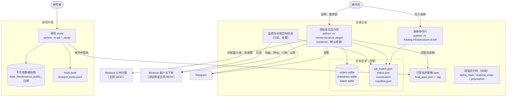
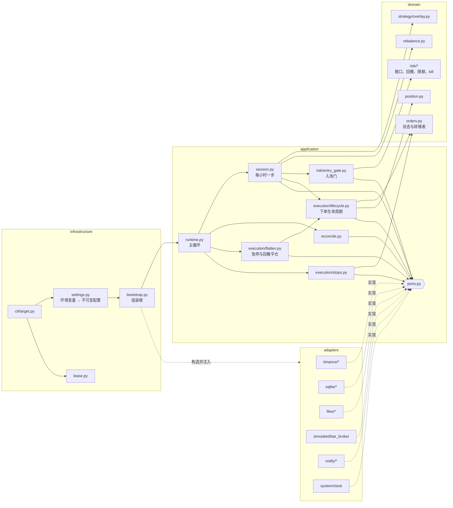

# 目标架构（阶段 2）

- 依据：`docs/arch/current-state.md`（HEAD `e3cd2d6`）。
- 状态：**已批准**（2026-11-14）。每个取舍的实际批准范围与未答事项以对应 ADR 的状态行为准。凡是会改变交易或风控行为的地方都在 ADR 里单独列出。

## 1. 目标与范围

### 1.1 要解决什么

`current-state.md` 第 7 节的五个结构性结论，对应五个目标：

| 现状 | 目标 |
|---|---|
| 候选运行时被已关闭的 ML 系统拖着 | 候选运行时放进一个独立的包，不 import 任何遗留代码 |
| 退出侧不可靠（R1–R7） | 退出路径有明确语义、有测试、失败时有告警 |
| 没有端口，订单库被 7 个以上文件直接写 SQL | 交易所、行情、存储、时钟、通知都经过端口；每张表只有一个写入者 |
| 约一半代码不在运行路径上 | 新包里只有在用的代码；遗留代码在边界之外，按批次处置 |
| 安全网不均匀，没有架构规则 | 每条不变量对应一个自动检查，全部进 CI |

### 1.2 范围

- **范围内**：Binance USDT-M 上的目标仓位运行时（现在的 `runner.binance_target`）及其依赖的策略、风控、执行、持久化和研究撮合。
- **范围外，原地冻结**：ML 线（`engine`、`decision`、`features`、`alpha`、`runner/binance_main.py`、`runner/offline` 的 ML 部分）、Bybit / OKX / Polymarket、`rust_bin`。它们不迁入新包，只接受安全修改和删除。去留见 ADR-0008。
- 新包名用 `trading/`。仓库里没有同名目录。

## 2. 分层与依赖规则

### 2.1 四层

依赖只能向内：`infrastructure → adapters → application → domain`。

| 层 | 放什么 | 允许依赖 | 禁止 |
|---|---|---|---|
| `trading/domain` | 策略函数、再平衡、订单与状态转移表、持仓投影、风控规则。全部是纯计算 | 标准库的纯计算模块、numpy、pandas | 任何 I/O：`sqlite3`、`urllib`、`socket`、`subprocess`、`time`、`logging`、`os`；Rust 扩展 `_quant_hotpath` |
| `trading/application` | 用例（每小时决策、下单生命周期、止损维护、急停平仓、对账）和端口定义 | `domain`；`logging` | 同上，但允许 `logging`（2026-11-14 实施时调整）。时间只能经 `Clock` 端口取得 |
| `trading/adapters` | 端口的实现：Binance REST、SQLite、文件、模拟交易所、通知、系统时钟 | `application` 的端口、`domain` | 读环境变量；适配器之间互相 import |
| `trading/infrastructure` | 配置加载（唯一读环境变量的地方）、组装根、命令行入口、进程租约、日志设置 | 以上全部 | — |

研究代码（现在的 `lab/*_study.py`）是另一个入口：它依赖 `trading.domain` 和 `trading.adapters.simulated`，不属于 `trading/`。

### 2.2 包结构

```
trading/
  domain/
    market.py            Bar、资金费、可见时间（available_at）语义
    strategy/overlay.py  StrategySpec、compute_targets、latest_target
    rebalance.py         Intent、plan
    orders.py            OrderIntent、OrderStatus、合法转移表、Fill
    position.py          StrategyPosition
    risk/exposure.py     3 倍上限常量与判定函数
    risk/drawdown.py     周期键、高水位、触发与闩锁规则
    risk/limits.py       单笔 / 日累计 / 频率限额规则
    risk/kill.py         KillState
  application/
    ports.py             全部端口（Protocol）
    session.py           每小时一步：行情 → 目标 → 意图 → 提交
    runtime.py           主循环编排：预热、轮询、对账、风险动作
    execution/lifecycle.py   意图预留、发单、查询、成交入账、结算
    execution/stops.py       交易所侧止损维护
    execution/flatten.py     急停与回撤平仓
    risk/entry_gate.py       入场组合门
    reconcile.py             账本与交易所核对
  adapters/
    binance/             rest、adapter（一个类实现行情、账户、下单、止损四个端口）
    sqlite/              order_journal、drawdown_store、limit_store、paper_store
    files/               kill_file、event_log、status_file、signed_spec
    simulated/           bar_broker（研究撮合模型，纸面与研究共用）
    notify/              telegram、null
    system/              clock、sleeper
  infrastructure/
    settings.py          环境变量 → 带校验的不可变配置对象
    bootstrap.py         组装根
    cli/target.py        运行时入口
    cli/kill.py          急停命令行
    lease.py
```

### 2.3 规则的自动化检查

用 import-linter 在 CI 里检查。下面是最初的草案；实际生效的契约见仓库根目录 `.importlinter`（2026-11-14 第 3 步审计后加严：`no-legacy` 同时禁止 `_quant_hotpath` 和 `tests`；`core-no-io` 还禁止 `pathlib`、`io`、`shutil`、`random`、`tempfile`、`glob`、`importlib`；另有 `domain` 不得 import `logging`；"适配器互不依赖"在第 8 步加入）：

```ini
[importlinter]
root_package = trading
include_external_packages = True

[importlinter:contract:layers]
name = trading 的依赖只能向内
type = layers
layers =
    trading.infrastructure
    trading.adapters
    trading.application
    trading.domain

[importlinter:contract:no-legacy]
name = trading 不依赖遗留包
type = forbidden
source_modules = trading
forbidden_modules = runner, shared, execution, engine, decision, features, alpha,
    strategy, event, state, risk, data, monitoring, attribution, infra,
    polymarket, scripts, research, lab

[importlinter:contract:core-no-io]
name = domain 与 application 不做 I/O
type = forbidden
source_modules = trading.domain, trading.application
forbidden_modules = sqlite3, urllib, http, socket, subprocess, time, _quant_hotpath

[importlinter:contract:adapters-independent]
name = 适配器之间互不依赖
type = independence
modules = trading.adapters.binance, trading.adapters.sqlite, trading.adapters.files,
    trading.adapters.simulated, trading.adapters.notify, trading.adapters.system
```

import-linter 查不了的规则用 AST 测试补（`tests/architecture/test_rules.py`）。除下面两条外，还检查 `domain`、`application` 中不经 import 就能做的 I/O（`open()`、`__import__()`、`Path.write_text()`、`datetime.now()` 等）：

- `os.environ` / `os.getenv` 只出现在 `trading/infrastructure/`。
- `trading/domain` 不 import `logging` 和 `os`。

迁移期间，旧位置的模块变成只做重导出的薄壳（例如 `lab/strategy.py` 重导出 `trading.domain.strategy.overlay`）。所以"遗留包 import 新包"是允许的，反方向被 `no-legacy` 契约禁止。

## 3. 端口

端口的方法集合来自现有代码的实际调用点（`current-state.md` 2.2 的 V8–V10，以及订单生命周期追踪）。全部用 `typing.Protocol` 定义在 `trading/application/ports.py`。方法名沿用现有命名，这样现有的适配器和测试用假交易所不改代码就符合端口。

| 端口 | 方法 | 现在的直接调用点 | 目标适配器 |
|---|---|---|---|
| `MarketData` | `get_klines(symbol, interval, limit, now_ms)`、`get_funding_history(symbol, limit)` | `runner/binance_target.py:277,279,328,334` | `adapters.binance.market_data`；研究用 CSV 快照 |
| `ExchangeAccount` | `get_account_equity()`、`get_positions(symbol, strict)`、`get_open_orders(symbol, strict)`、`filters(symbol)`、`execution_blockers()`、`get_ticker(symbol)` | `shared/exposure_gate.py:26,30,34`；`execution_adapter.py:165,260-277`；`runner/binance_target.py:236,291` | `adapters.binance.account`；`adapters.simulated` |
| `OrderGateway` | `send_market_order(...)`、`send_limit_order(...)`、`get_order(...)`、`cancel_order(...)`、`get_recent_fills(symbol, order_id, limit)` | `shared/confirmed_execution.py:176,185,189,226,249,254` | `adapters.binance.order_gateway`；`adapters.simulated` |
| `StopOrderGateway` | `place_stop_market(...)`、`get_algo_order(...)`、`cancel_algo_order(...)` | `protective_stops.py:87,103,106,125` | `adapters.binance.stop_gateway` |
| `OrderJournal` | `reserve(intent)`、`transition(intent_id, to)`、`record_fill(...)`、`settle(...)`、`unresolved(...)`、`undelivered(owner)`、`consume(owner, fill_id, apply)`、`checkpoint(owner)`、`adopt(...)`、止损行的读写 | 7 个以上文件直接写 SQL（V8） | `adapters.sqlite.order_journal`，三张订单表和止损表的唯一写入者 |
| `DrawdownStore` | `load(scope, period)`、`save(...)`、`observe(...)` | `shared/drawdown_guard.py:45` | `adapters.sqlite.drawdown_store` |
| `LimitStore` | `load_day(scope, day)`、`add(...)` | 现在在 Rust 进程内存里 | `adapters.sqlite.limit_store` |
| `KillSwitch` | `state()` | `runner/binance_target.py:258,316` | `adapters.files.kill_file` |
| `SpecSource` | `load_verified()` | `runner/binance_target.py:52-58,386` | `adapters.files.signed_spec` |
| `Clock`、`Sleeper` | `now()`、`sleep(s)` | `time.time` / `time.sleep` 散落在 5 个文件 | `adapters.system`；测试用假时钟 |
| `Notifier` | `alert(level, title, detail)` | 资金路径上没有任何调用 | `adapters.notify.telegram`、`null` |
| `EventLog`、`StatusSink` | `write(kind, **fields)`、`publish(status)` | `runner/binance_main.py:130-133`；`runner/binance_target.py:363-365` | `adapters.files` |
| `PaperStore` | `load()`、`save(state)` | 不存在，纸面状态只在内存 | `adapters.sqlite.paper_store` |

约束：

- 应用层的构造参数全部用端口类型，不再出现 `Any`。
- 执行模式下，入场门的 kill、回撤、敞口、限额四个组件必须齐全，缺任何一个在构造时抛错。
- 适配器不读环境变量。所有配置由 `infrastructure.settings` 读一次，校验后以不可变对象传入。

## 4. C4 容器图



说明：

- 运行时是单进程、单线程。纸面和执行是同一个进程的两种组装方式。
- systemd 的 `ExecStart` 不变，仍是 `python3 -m runner.binance_target`。这个模块在迁移后是一个转发到 `trading.infrastructure.cli.target` 的薄壳。
- 状态目录是"受管"的：带清单和账户身份，执行模式下缺库拒绝启动（ADR-0007）。
- 遗留运行时与新运行时不共享代码路径，也不共享状态目录。

## 5. C4 组件图（目标仓位运行时内部）



要点：

- 入场订单到达 `OrderGateway` 的唯一路径是 `session → entry_gate → lifecycle`。`adapters.binance` 只在 `bootstrap` 里被构造，应用层拿不到具体类。
- 减仓不经过入场门（与现在一致），但经过同一个 `lifecycle`，所以"至多发一次、只认交易所成交"对减仓同样成立。
- 纸面模式把 `BIN` 换成 `SIMX`，其余组件不变（ADR-0006）。

## 6. 现有文件 → 目标位置

| 现有 | 目标 | 方式 |
|---|---|---|
| `lab/strategy.py`、`lab/data.py` 的聚合函数 | `trading/domain/strategy/overlay.py`、`trading/domain/market.py` | 移动，旧位置留薄壳 |
| `lab/rebalance.py` | `trading/domain/rebalance.py` | 移动 |
| `shared/strategy_position.py` | `trading/domain/position.py` | 移动 |
| `lab/orders.py`（依赖 Rust 事件类型） | `trading/domain/orders.py`（纯 Python 数据类） | 重写，约 40 行 |
| `shared/exposure_gate.py` | 规则 → `domain/risk/exposure.py`；取数 → `application/risk/entry_gate.py` 经 `ExchangeAccount` | 拆分 |
| `shared/drawdown_guard.py` | 规则 → `domain/risk/drawdown.py`；存储 → `adapters/sqlite/drawdown_store.py` | 拆分 |
| `execution/safety/limits.py` + Rust 限额器 | `domain/risk/limits.py` + `adapters/sqlite/limit_store.py` | 重写为纯 Python（ADR-0008） |
| `shared/entry_risk.py` | `application/risk/entry_gate.py` | 移动并加类型 |
| `shared/confirmed_execution.py` | `application/execution/lifecycle.py` | 移动；SQL 移入适配器 |
| `shared/execution_journal.py` | `adapters/sqlite/order_journal.py` | 移动并扩展为唯一写入者 |
| `execution/adapters/binance/execution_adapter.py` | 减仓定量与对账 → `application`；其余并入 `lifecycle` | 拆分 |
| `execution/adapters/binance/protective_stops.py` | `application/execution/stops.py` | 移动；SQL 移入适配器 |
| `execution/adapters/binance/adapter.py`、`rest.py` | `adapters/binance/*`。先由一个类实现四个端口，按端口拆成多个类留作后续 | 移动 |
| `shared/kill_file.py` | `adapters/files/kill_file.py` + `infrastructure/cli/kill.py` | 拆分 |
| `infra/model_signing.py` 的验签 | `adapters/files/signed_spec.py` | 移动在用部分 |
| `runner/offline/broker.py` 的 `BarBroker` | `adapters/simulated/bar_broker.py` | 移动 |
| `lab/simulate.py` | 研究侧保留 `simulate()`；`Sleeve` 的职责由 `application/session.py` + 模拟适配器承担 | 见 ADR-0006 |
| `runner/binance_target.py` | `application/runtime.py`、`application/session.py`、`infrastructure/bootstrap.py`、`infrastructure/cli/target.py` | 拆分；旧文件留薄壳 |
| `runner/binance_main.py` 的 6 个符号 | 各归其位（`EquitySource` → application，`EventJournal` → adapters.files，`build_adapters` → bootstrap） | 复制后切断依赖 |
| `shared/execution_lease.py` | `infrastructure/lease.py` | 移动 |

## 7. 不变量清单与自动化检查

2026-11-15 按 `design-2026-11-m5.md` 第 7 节更新（原表停在 2026-11-14，L5、L6、K2–K5、S1、S2 已修复却仍标 ✗）。表中 T1–T10 是这次设计新增的不变量；"没有"的项由设计第 10 节的对应步骤补上。S1 步骤之后，T1（测试不联网）和 T2（规格只经签名加载）已有检查：`tests/conftest.py` 的网络屏蔽与 `tests/unit/tooling/test_network_guard.py`，以及 `tests/architecture/test_artifact_loading.py`。

| 不变量 | 现在的自动检查 | 状态 |
|---|---|---|
| L1 3 倍上限只定义一次 | 【测试日志】`tests/architecture/test_rules.py::test_the_hard_leverage_cap_is_defined_once` | 有 |
| L2 每张入场单都经过入场门 | 【测试日志】`tests/characterization/test_runtime_decisions.py::test_the_entry_gate_as_the_runtime_assembles_it`；但模拟盘路径绕过入场门【代码 `session.py:173-175`】 | 部分（S10 之后成立） |
| L3 执行模式入场门的四个组件缺一不可 | 【测试日志】`tests/unit/trading/test_domain_risk.py` | 有 |
| L4 权益、持仓、状态库任何一项未知时拒绝入场 | 【测试日志】`tests/unit/trading/test_unknown_equity.py`、`tests/unit/trading/test_lost_state_files.py` | 有 |
| L5 回撤锁定和当日计数在重启后保持 | 【测试日志】`test_risk_state.py::test_drawdown_latch_survives_a_restart_with_the_same_file_and_scope`、`::test_the_daily_order_count_survives_a_restart` | 有 |
| L6 检查通过之前不写账户 | 【测试日志】`test_risk_state.py::test_the_mainnet_gate_refuses_before_any_account_setting_is_written` 等 3 条；ADR-0010 之后，连接账户本身也是只读的 | 有 |
| L7 没有自动提高上限的路径 | 回撤上限有硬顶，并有测试；还没有"配置对象不可变、启动后不再读配置"的架构测试 | 部分（S4） |
| K1 急停激活后没有新的入场 | 【测试日志】`tests/unit/trading/test_exit_robustness.py`、`test_exit_paths.py` | 有 |
| K2–K5 急停先撤后平；命令和运行时用同一个文件；运行时只读；没有止损就阻断 | 【测试日志】`test_exit_paths.py::test_kill_flatten_cancels_a_resting_entry_first_then_closes_the_position`、`test_state_dir.py::test_the_runtime_reads_the_kill_file_the_command_writes`、`::test_only_the_kill_command_writes_a_kill_file`、`test_stops_and_fills.py::test_a_position_without_a_working_stop_blocks_entries_until_one_is_in_place` | 有。K4 只能发现带 `active=` 参数的写调用，发现不了复制文件（审计 M1），S8 补 |
| K6 急停文件损坏或不可读按激活处理 | 【测试日志】`test_state_dir.py::test_in_a_managed_directory_a_kill_file_that_disappears_reads_as_active` | 有 |
| F1–F4 无前视 | 【测试日志】`tests/unit/trading/test_strategy_causality.py`、`tests/unit/lab/test_lab_engine.py::test_targets_are_causal`、`tests/unit/binance/test_binance_adapter.py::test_klines_closed_only_and_ascending`、`tests/unit/data/test_causal_bars.py` | 有 |
| F5 前向窗口只在登记的查看里读取 | `lab/forward.py` 的拒绝逻辑有测试；数据加载函数没有日期上限 | 部分 |
| O1 同一意图至多提交一次；O4 只有交易所成交才入账、恰好一次 | 【测试日志】`tests/offline/test_execution_safety.py`、`tests/characterization/test_order_facts.py` | 有 |
| O2 状态只能按转移表变化 | 【测试日志】`test_order_transitions.py` 固定了转移表；生产中只记录、不拒绝（ADR-0004，M5 之后再定） | 部分 |
| O3 订单表只有一个写入者 | 【测试日志】`tests/architecture/test_rules.py::test_sqlite_is_imported_only_by_the_sqlite_adapters` | 有 |
| O5 崩溃重启不重复下单、不丢成交 | 【测试日志】`tests/offline/test_execution_recovery.py`、`test_target_runtime_resilience.py::test_paper_restart_while_orders_are_pending_reproduces_lab_simulation`、`test_startup_account_check.py` 的恢复类测试 | 有 |
| O6 减仓被拒绝时记日志 | 【测试日志】`test_flatten.py::test_a_reduction_refused_by_the_order_journal_is_logged_with_its_reason` | 有 |
| P1 模拟盘与研究逐笔相同 | 【测试日志】`test_target_runtime.py::test_paper_runtime_reproduces_lab_simulation` 等 | 有（S10 面临的主要风险） |
| P2 模拟盘与执行用同一份会话代码 | 没有 | **没有**（S10） |
| P3 模拟盘状态跨重启连续 | 【测试日志】`test_target_runtime_resilience.py` | 有 |
| P4 研究与实盘共用的参数只有一个来源 | 限价偏移写了三份【代码 `lab/simulate.py:39`、`runner/offline/broker.py:38`、`trading/infrastructure/target.py:48`】 | **没有**（S10） |
| S1 依赖只能向内，核心层不做 I/O | `.importlinter` 5 条契约，加 `tests/architecture/test_rules.py` | 有 |
| S2 资金相关测试都在 CI 门禁里 | 【测试日志】`test_rules.py::test_money_path_tests_are_gated_in_ci_and_make`、`::test_the_ci_shards_together_are_the_whole_suite` | 有 |
| T1 测试从不联网 | `tests/conftest.py` 屏蔽本机以外的连接和域名解析；`tests/unit/tooling/test_network_guard.py` | 有（S1） |
| T2 策略规格和模型只经签名校验加载 | `tests/architecture/test_artifact_loading.py`：生产代码不用 pickle 一类的反序列化；运行时的规格只经 `load_verified_json` 读取 | 有（S1） |
| T3 主网执行单元不自动重启 | 没有 | **没有**（S8） |
| T4 运行中出现外来持仓就阻断入场，而且阻断持续到外来持仓消失 | 没有（G5 还没实现） | **没有**（S5） |
| T5 执行模式没有告警出口、启动告警没送达、没有心跳地址时不能启动 | 没有 | **没有**（S7） |
| T6 启动之后不再读配置；配置日志里不含密钥和心跳地址 | 只有"只有组装层读环境变量"这一条 | **没有**（S4） |
| T7 一个账户身份同时只有一个执行进程；运行时在跑时，手工工具和恢复命令拒绝执行 | 已知缺陷测试固定了现状（R20）；手工工具按状态目录的租约拒绝 | **不成立**（S6） |
| T8 恢复只收紧、不放宽风险状态 | 没有 | **没有**（S8） |
| T9 心跳失败不影响平仓和对账 | 没有 | **没有**（S7） |
| T10 模拟盘不构造带凭据的适配器、不发签名请求 | 没有 | **没有**（S10） |

## 8. 关键决策

每条都有 ADR。批准情况见各 ADR 的状态行（2026-11-14）。

| ADR | 决策 | 建议 |
|---|---|---|
| [0001](../adr/0001-migration-scope-and-strangler-boundary.md) | 迁移范围与新旧边界 | 新建 `trading/` 包，只迁候选运行时；遗留代码原地冻结 |
| [0002](../adr/0002-layering-and-enforcement.md) | 分层方式与强制手段 | 四层 + import-linter；组装根在最外层 |
| [0003](../adr/0003-ports.md) | 端口粒度 | 按能力拆成小端口，用 `Protocol` |
| [0004](../adr/0004-order-state-machine-and-journal-ownership.md) | 订单状态机与订单库所有权 | 状态枚举加转移表放在 `domain`；SQLite 适配器是唯一写入者 |
| [0005](../adr/0005-exit-path-semantics.md) | 急停、平仓、止损的语义 | **改变风控行为，需要您逐项确认** |
| [0006](../adr/0006-one-session-for-paper-and-live.md) | 纸面与实盘是否同一份会话代码 | 同一份，换适配器 |
| [0007](../adr/0007-state-durability.md) | 状态持久化 | 受管状态目录；缺库拒启；限额计数与纸面状态落盘 |
| [0008](../adr/0008-legacy-code-and-rust.md) | 遗留代码与 Rust 扩展的处置 | 新路径不依赖 Rust；死代码分批删除；冻结线加执行硬开关 |

## 9. 明确不做的事

- 不改策略数学、不改任何风控阈值的数值。
- 不迁移 ML 线和其他交易所的代码。
- 不引入新的外部依赖作为运行时依赖。import-linter 只在开发与 CI 环境使用。
- 不引入消息总线、异步框架或多进程。运行时保持单进程单线程轮询。
- 不改 systemd 单元的 `ExecStart`。
